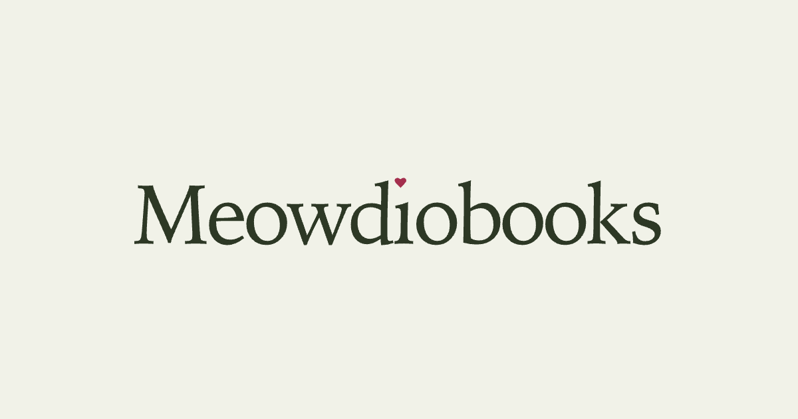

<p align="center"></p>

<p align="center"><strong>Your books. A cast of voices.</strong><br>Turn PDF, EPUB and text into multi-voice audiobooks on your Mac.</p>

<p align="center">English · <a href="README.zh-CN.md">简体中文</a><br><a href="#hear-it">Hear it</a> · <a href="#see-it">See it</a> · <a href="#make-it-yours">Models</a> · <a href="#install">Install</a> · <a href="docs/README.md">Docs</a> · <a href="#built-together">Community</a></p>

Meowdiobooks finds the dialogue, helps you build the cast, and gives each character a voice you
can design or clone. Review the text, audition the voices, then generate chapters and export an
M4B or MP3 audiobook. Voice production runs locally on Apple Silicon.

## Hear it

**The Last Door** — a 36-second scene with a narrator, distinct character voices and a shared line.

https://github.com/user-attachments/assets/465134c0-cbe0-45bc-a1d1-16fab52ff70f

[Download the audio](docs/demo/the-last-door.mp3) · [Read the passage](docs/demo/README.md)

## See it

<p align="center"></p>

<table>
  <tr>
    <td width="50%">
      
      <br><strong>Start with the page.</strong> Check extracted text against the original.
    </td>
    <td width="50%">
      
      <br><strong>Find the right voices.</strong> Design, audition and choose your cast.
    </td>
  </tr>
</table>

<details>
<summary>See the studio in dark mode</summary>


</details>

*Screenshots use public-domain Alice in Wonderland passages and demonstration data.*

## From book to audiobook

- **Bring your book.** Import PDF, EPUB, TXT or Markdown. Compare PDF extraction methods and
  check dialogue against the source.
- **Build the cast.** Review proposed speakers, bring a character's names and aliases together,
  and choose a consistent voice for each character.
- **Direct the voices.** Adjust voice traits or clone a voice from a short audio sample.
  Listen to auditions before committing to the cast.
- **Finish at your pace.** Resume interrupted generation, export chaptered M4B or MP3,
  and keep completed audiobooks in your local Library.

## Make it yours

The default setup runs book analysis, voice design, cloning and audio generation on your Mac.
Text cleanup Review uses OpenAI with your own API key; you can also choose OpenAI for dialogue
analysis. These cloud steps send book excerpts to OpenAI. Books, voice samples, accepted work and
exports are stored locally.

**Bring your own models:** configure compatible local models and supported provider profiles in
[`models.toml`](models.toml). The [model guide](docs/MODELS.md) covers downloads, replacements and
compatibility. No Meowdiobooks account or subscription is required.

### A few things to know

- The supported setup is **macOS on Apple Silicon**, with manual installation of the local models.
- Review currently needs an **OpenAI API key**. Replacing the other models does not make that step offline.
- Check extracted text and speaker assignments before generating a full book, especially for
  complex PDFs or unusual dialogue. [Supported formats and review limits](docs/KNOWN_GENERALIZATION_RISKS.md).

## Install

Plan for **18 GB unified memory**, roughly **30 GB free storage**, and about **15 GB of model downloads**.
The [setup guide](docs/SETUP.md) has the full requirements and troubleshooting steps.

**1. Install the tools and build the app.**

```bash
brew install python@3.12 uv node poppler ffmpeg
npm install --global @llamaindex/liteparse

git clone https://github.com/PetarKing/meowdiobooks.git
cd meowdiobooks
npm --prefix frontend ci
npm --prefix frontend run build
uv sync --extra mlx-runtime
```

**2. Set up your models and API key.** Follow the [model setup guide](docs/MODELS.md) to install the
local runtime and model files. Set `OPENAI_API_KEY` in your environment or the ignored local `.env`
file for Review. The commands above do not download models.

**3. Check your setup and start the studio.**

```bash
uv run meowdiobooks doctor
uv run meowdiobooks serve
```

Once `doctor` passes, start the server and open **<http://127.0.0.1:8000>**.

## Built together

For as long as we offer Meowdiobooks commercially, we will maintain this personal, self-hosted
edition and publish improvements to the shared audiobook workflow. It will remain usable without
a Meowdiobooks account or subscription.

Bug reports, better model support, documentation and code contributions all help. Improvements
from the community can benefit personal and paying users alike, just as our work on the common
engine benefits both. Read [our commitment](docs/COMMUNITY.md) or [get involved](docs/CONTRIBUTING.md).

## License

Source-available under [PolyForm Noncommercial 1.0.0](LICENSE), for permitted noncommercial use.
Commercial use requires separate permission. External contributions follow the
[Contributor License Agreement](CLA.md).
