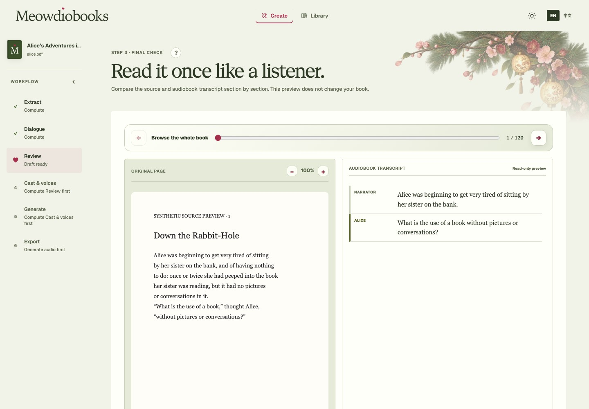
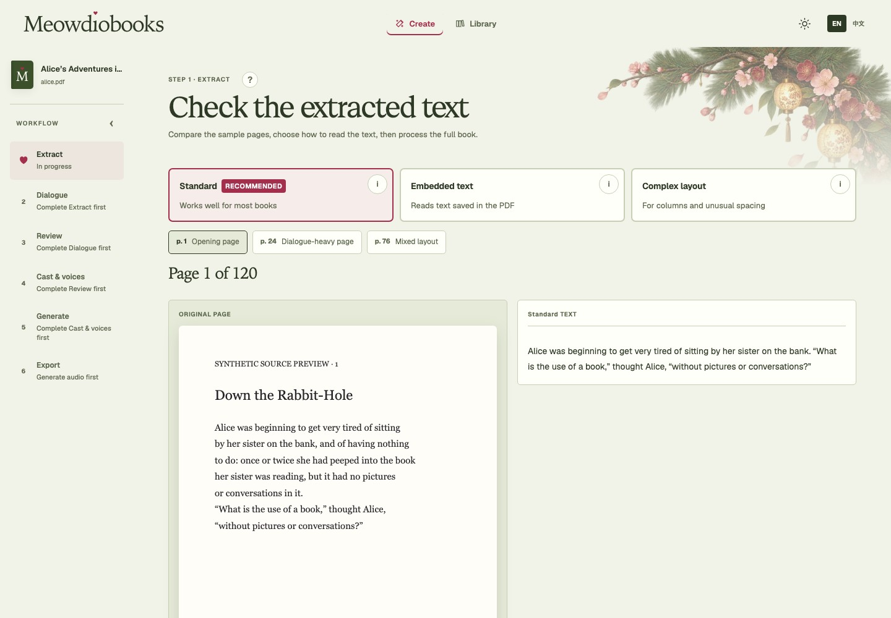
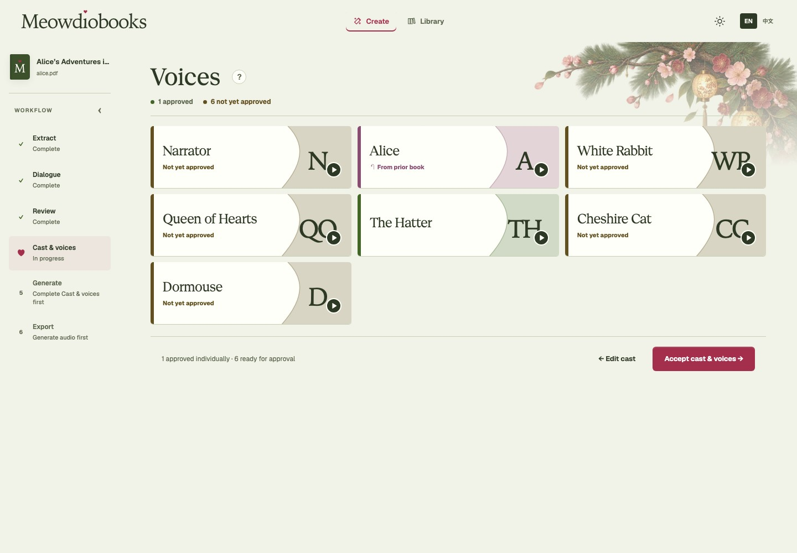

# Meowdiobooks

[English](README.md) | 简体中文


> **Alpha · macOS · Apple Silicon**——完整流程默认可在本地运行。当前版本面向愿意按照文档安装
> 本地模型，并审核关键 AI 辅助判断的早期用户。整本书的处理都保留在你的 Mac 上，速度取决于本机硬件。

**通过让你始终掌握决定权的 AI 原生工作流程，把原始 PDF 转化为富有表现力的多角色有声书。**

Meowdiobooks 处理从原文到声音之间的制作工作：文本提取、对话归属判定、角色统一、
声音设计或本地克隆、章节渲染和 M4B 导出。它面向那些并不像整洁剧本一样规整的真实书籍，
在需要理解语义的地方使用聚焦的 AI，同时保留原文，也不会代替用户做出所有决定。

## AI 原生，由用户主导

- **真正有用的自动化，而不是黑箱。** 确定性处理保留原文；聚焦的 AI 只处理范围明确的
  文学判断，而不是把整本书重写为一份猜测出来的脚本。
- **审核真正重要的决定。** 不确定的说话人、角色关系、提取警告和声音选择在进入最终音频前
  始终可见、可修正。
- **在本地设计或克隆声音。** 可以调整 Qwen 的声音特征，也可以提供一段 3–30 秒的 WAV、MP3
  或 FLAC 样本。本地语音识别会生成可修正的文本草稿；审核后的音频与文本会成为该角色私有、
  仅属于当前书籍的声音参考。
- **默认本地，选择远程时也关注成本。** 完整流程可在受支持的 Mac 上运行。对于较大的“对话”
  审核任务，只有在用户明确选择 OpenAI 兼容配置后，选中的原文片段才会发送给配置的服务商，
  并在运行前显示预估成本。

## 看看实际工作流程

<p align="center">
  
</p>

<table>
  <tr>
    <td width="50%">
      
      <br><strong>始终看得见原文。</strong>在处理整本书前，先把不同提取方式与原始 PDF 对照检查。
    </td>
    <td width="50%">
      
      <br><strong>让 AI 提建议，由你做决定。</strong>把原文标签统一为角色，检查证据，再试听并接受每个声音。
    </td>
  </tr>
</table>

截图使用仓库内简短的公版《爱丽丝梦游仙境》评测样例。同一套引导式流程既可用于四页的验证样例，
也可用于完整书籍。

## 为真实书籍而设计

| 复杂的原文示例 | Meowdiobooks 的处理方式 |
|---|---|
| `Mara: “Run.”` | 根据原文位置检测对话，无需让模型重新寻找已存在的内容 |
| `Mara unfolded the note. “Do not open it,” she read aloud.` | 让聚焦的 AI 阅读有限范围内的上下文，并建议由 `Mara` 说出这句话，交给用户审核 |
| `???: “You should not have come here.”` | 明确保留不确定性，并通过经过审核的旁白兜底处理未知说话人 |
| `Dr. Vey: “Stay still.”`……稍后出现 `“Breathe,” the doctor said.` | 将审核过的原文标签统一为稳定的角色身份和一致的声音 |
| `LIN & MARA: “Together.”` | 区分群体与个人，并可在同一时间点混合明确成员的声音 |
| `The sign read “DO NOT OPEN.”` | 聚焦的 AI 可以把引号内容标记为书面文字而非对话，并继续交给旁白朗读 |
| `Mara: [Wait— “No,” Lin interrupted.]` | 显示对同一段原文的冲突判断，并阻止接受，而不是静默选择或丢弃文本 |

系统有意采取保守策略：它不会对全书进行不透明的重写，然后把结果当作确定事实。
请参阅[当前覆盖范围与审核边界](docs/KNOWN_GENERALIZATION_RISKS.md)，了解对情节相关别名、
角色形态变化、特殊对话格式及文本提取限制的具体处理边界。

## 听听生成效果

**[试听演示 WAV](docs/demo/meowdiobooks-demo.wav)** ·
[阅读单页原文并查看每一步转换](docs/DEMO.md)

演示原文包含别名、未知说话人、同时发声、并非对话的引用文字以及旁白内容。
演示说明展示了 Meowdiobooks 使用的审核后产物；链接中的音频由正式渲染器根据已接受的
角色阵容和渲染计划生成：

```text
PDF → 提取文本 → 对话归属判定 → 角色统一 → 声音选角 → WAV / M4B
```

| 原文证据 | 接受后的结果 | 音频行为 |
|---|---|---|
| `Mara`、`Dr. Vey`、`the doctor` | 同一个角色身份 | 使用同一个声音 |
| `???` | 未解决的说话人 | 如实使用旁白兜底 |
| `LIN & MARA: Together.` | 明确的群体台词 | 在同一时间线上混合多个声音 |
| `She read “DO NOT OPEN”...` | 引用的是书面文字，而非对话 | 由旁白朗读 |

## 工作流程的其余部分

- 从 PDF 原文位置到已接受的对话、角色身份、声音和渲染事件，始终保留精确且可检查的链路。
- 检测文本提取、内容覆盖、章节、重复内容、页码和脚注问题，供用户审核。
- 为每个角色生成可比较的声音试演，并固定用户实际接受的精确版本。
- 支持从上传样本进行本地声音克隆，包括自动语言检测、可编辑的文本草稿，以及使用统一试听台词
  生成的克隆试听。
- 在“生成”首次需要时，根据已接受的上游版本准备一份忠实的最终录音脚本。
- 以原子方式发布完整且带版本的 WAV 章节，将当前章节打包为 M4B，并把完成的导出保存在本地资料库中。
- 默认将书籍内容和模型推理保留在 Mac 上；可选的远程“对话”处理只会把用户选中的片段
  发送给用户配置的服务商。

导入本地 PDF 后，引导流程依次为 **提取（Extract）→ 对话（Dialogue）→ 审核（Review）→
角色与声音（Cast & Voices）→ 增强（Enrichment，目前仅为直通步骤）→ 生成（Generate）→ 导出（Export）**。
具体阶段行为请参阅[工作流程指南](docs/wizard/README.md)。

## Alpha 范围

目前，Meowdiobooks 在 Apple Silicon Mac 上支持最大 500 MB 的本地 PDF。
PDF 文本提取、对话归属判定、角色统一、声音设计与克隆、章节生成和 M4B 导出均可工作。
此 Alpha 版本用于测试与完善，不适合无人值守的生产使用：结果具有概率性，
已保存的 Alpha 数据可能在版本升级后不兼容，而且目前还没有受支持的模型安装器。

**下一步：**让设置与审核更简单，扩展输入格式和硬件支持，并持续改进对话与音频质量。
托管版本和更丰富的角色感知聆听体验也属于计划方向。详情请参阅[路线图](docs/ROADMAP.md)。

## 模型

[`models.toml`](models.toml) 是运行时的唯一配置依据；[模型指南](docs/MODELS.md)列出了固定版本、
下载命令、预期路径和兼容规则。完整的默认本地模型约占 14 GB。

| 步骤 / 用途 | 路由 | 默认模型 | 兼容配置 |
|---|---|---|---|
| 对话归属判定、角色身份分类和声音建议 | 本地 | 通过固定版本 `llama.cpp` 运行的 Qwen3.5 9B Q4_K_M | 使用受支持 `llama_cpp` 引擎并遵守相同已验证提示词/输出契约的注册项 |
| 大型“对话”审核（仅在明确选择时） | 可选远程 | 通过已配置 OpenAI Responses 配置运行的 `gpt-5.6-luna` | 满足有限范围响应契约的 OpenAI 兼容 Chat Completions 或 Responses 配置；只有选中的“对话”片段会离开本机 |
| 设计声音试听 | 本地 | [`mlx-community/Qwen3-TTS-12Hz-1.7B-VoiceDesign-bf16`](https://huggingface.co/mlx-community/Qwen3-TTS-12Hz-1.7B-VoiceDesign-bf16) | 与 Base 渲染器配对、并明确验证语言列表的兼容 MLX-Audio VoiceDesign 检查点 |
| 声音样本文本草稿（STT） | 本地 | 支持自动语言检测的 [`mlx-community/Qwen3-ASR-0.6B-4bit`](https://huggingface.co/mlx-community/Qwen3-ASR-0.6B-4bit) | 实现相同可编辑文本/语言结果的兼容 MLX-Audio Qwen3-ASR 检查点；未来 Linux 适配器可保持此边界不变 |
| 声音克隆试听 | 本地 | 使用上传参考 WAV 与修正文本的 [`mlx-community/Qwen3-TTS-12Hz-1.7B-Base-4bit`](https://huggingface.co/mlx-community/Qwen3-TTS-12Hz-1.7B-Base-4bit) | 支持 `ref_audio` + `ref_text` 文本条件克隆的兼容 Base 检查点 |
| 章节生成 | 本地 | 同一个 Qwen3-TTS Base 1.7B 4-bit 渲染器 | 所选声音流水线中的 Base 模型，并支持全部已配置书籍语言 |

声音克隆不会使用额外的合成模型：Qwen3-ASR 先提供可编辑的文字建议，再由章节生成所使用的
同一个 Qwen3-TTS Base 渲染器克隆修正后的音频/文本参考。VoiceDesign、Base TTS 和 STT
都保留在本地；只有可选的远程“对话”路由会向外发送有限范围的文本。

## 在本地运行

要求：搭载 Apple Silicon（`arm64`）的 macOS，约 18 GB 统一内存、30 GB 可用存储空间，
以及约 14 GB 的固定版本本地模型文件。
首先安装标准开发及媒体依赖：

```bash
brew install python@3.12 uv node poppler ffmpeg
npm install --global @llamaindex/liteparse
```

Poppler 用于渲染 PDF 页面预览；LiteParse 是可用的文本提取方式之一；
FFmpeg 用于把生成的章节打包为 M4B。

```bash
# 克隆或下载此仓库，然后执行：
cd meowdiobooks
uv sync --extra mlx-runtime
npm --prefix frontend ci
npm --prefix frontend run build
uv run meowdiobooks doctor
uv run meowdiobooks serve
```

在 `doctor` 可以通过之前，请按照[本地模型指南](docs/MODELS.md)安装 llama.cpp 和配置中指定的
本地模型文件。这些文件不会由上述依赖安装命令自动下载。`mlx-runtime` 可选依赖会安装当前
Apple Silicon 推理后端所需的 Python 软件包；未来可将其他平台的运行时后端作为独立可选依赖
加入，而无需改变跨平台的应用核心。本地声音样本文本识别需要固定版本的
**Qwen3-ASR 0.6B 4-bit** 模型，并应放在 `models/qwen3_asr_0_6b_4bit/`；指南中列出了它与
文本、VoiceDesign 和 Base TTS 模型的精确版本及下载命令。安装完成后，`doctor` 会将其显示为
**Speech recognition**。启动 `serve` 后，打开
<http://127.0.0.1:8000>。

同一时间只能有一个后端使用同一个数据目录。第二个 `serve` 命令会在读取或修改任务状态前退出，
并显示正在运行的进程 PID。重新启动浏览器是安全的；正在进行的生成任务仍由原来的后端进程负责。

## 限制

- 目前仅支持 PDF 输入；不支持加密 PDF。
- 仅含图片、格式损坏、多栏或版式复杂的 PDF 可能提取不佳或失败。
- 对话归属判定、角色统一和声音设计都需要人工审核。
- 重型处理任务会针对单个本地用户串行执行，所需时间可能远长于最终音频的播放时长。
- 中断的任务会从当前阶段重新开始，而不是在阶段内部续传。
- 目前没有安装器、更新器、身份验证、局域网模式、内置播放器或手机连接。
- Meowdiobooks 不会绕过 DRM。你必须自行确认对所处理、生成、分享或使用的每本书及其输出
  拥有必要的权利和许可。本项目及其贡献者不授予任何第三方内容的权利，也不对违法或侵权使用
  承担责任。

技术细节请参阅[当前覆盖范围与审核边界](docs/KNOWN_GENERALIZATION_RISKS.md)。

## 相关工作

Meowdiobooks 专注于把对话密集型 PDF 完整转化为可审核的多角色作品：在一个引导式流程中完成
页面感知提取、基于原文位置的归属判定、明确的不确定性、角色与群体统一、声音试演、章节生成和
M4B 导出。目前的输入和硬件支持有意聚焦于 PDF 与 Apple Silicon。

其他开源项目探索了更广泛的有声书生成方向：

- [ebook2audiobook](https://github.com/DrewThomasson/ebook2audiobook) 支持更多输入/输出格式、
  语言、平台和 TTS 引擎，也包括 OCR 与声音克隆工作流程。
- [Alexandria Audiobook Generator](https://github.com/Finrandojin/alexandria-audiobook)
  提供可编辑的多声音工作室，包括 LLM 脚本标注与审核、声音克隆与设计，以及在更多 GPU 环境下
  对单个片段进行选择性重新生成。

这些项目更强调格式、模型或编辑能力的广度；Meowdiobooks 则更深入地保证原始 PDF 始终可检查，
并让 AI 与用户共同把它制作成角色连贯的有声书。

## 开发

```bash
uv run pytest -q
uv run ruff check src/meowdiobooks tests
npm --prefix frontend test -- --run
npm --prefix frontend run lint
npm --prefix frontend run build
```

拉取请求 CI 只安装跨平台核心，并跳过标记为 `uses_audio_decoder` 或 `runs_models` 的测试。
完整测试套件仍需在配置完毕且受支持的运行时环境中运行，作为发布前的信心检查。

贡献前请先创建 issue，说明用户价值、范围、受影响的契约、测试策略和依赖项。
新增服务、数据库、缓存、跨服务耦合或运行时依赖，必须在实现前获得维护者批准。
请参阅[贡献者参考](docs/CONTRIBUTING.md)。

## 文档

- [文档索引](docs/README.md)
- [演示：从原文到音频](docs/DEMO.md)
- [设置与模型文件](docs/SETUP.md)
- [本地模型与配置](docs/MODELS.md)
- [路线图](docs/ROADMAP.md)
- [工作流程指南](docs/wizard/README.md)
- [M4B 导出](docs/M4B_EXPORT.md)

## 许可证

Meowdiobooks 以 [PolyForm Noncommercial License 1.0.0](LICENSE) 作为源码可用许可证。
你可以在许可的非商业目的下使用、研究、修改和再分发本软件；商业使用不在授权范围内。
在法律允许的最大范围内，本软件按现状提供，不附带担保，许可方不承担责任。

外部贡献者必须接受[贡献者许可协议](CLA.md)。贡献者保留其贡献的所有权，同时允许这些贡献
用于 Meowdiobooks 的公开版本和托管版本。
