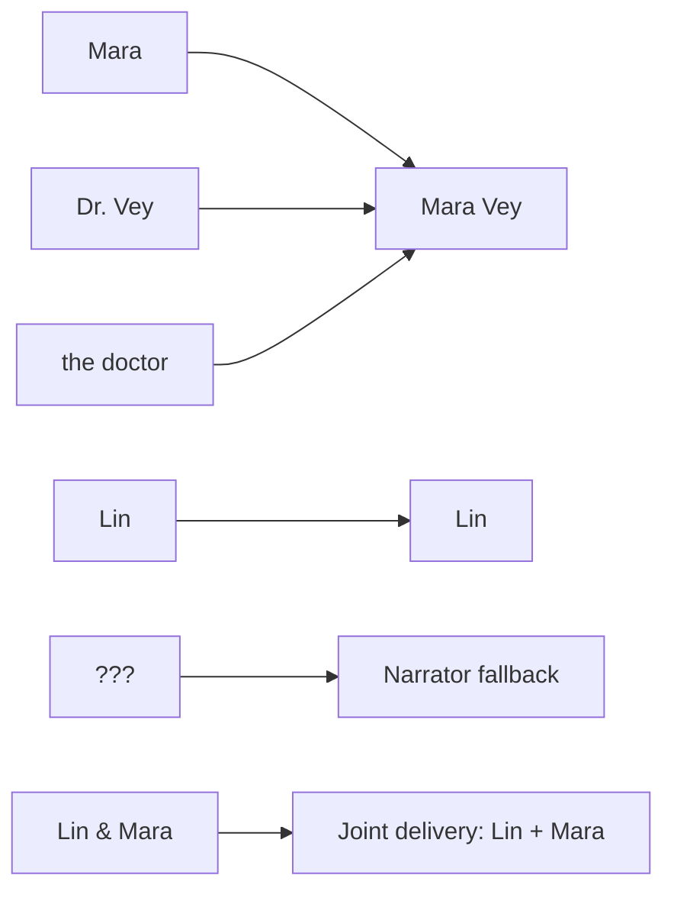

# Demo: from page to performance

This original, repository-owned scene illustrates the decisions that make cast audiobook generation
harder than reading paragraphs aloud. The tables below present the curated review outcome; they are
not a benchmark of automatic attribution accuracy. The [published demo WAV](demo/meowdiobooks-demo.wav)
was generated from this accepted cast and render plan with the production voice pipeline.

## 1. Source page

<details open>
<summary><strong>The Last Door — full one-page scene</strong></summary>

> Rain worried the observatory windows. Lin held the brass key up to the emergency lamp, but its
> teeth cast the shadow of a tiny city.
>
> **LIN:** Mara, tell me this is the key to the west stair.
>
> **DR. VEY:** It was, before someone folded the building.
>
> The doctor took the key. On its bow, an inscription read “DO NOT OPEN AFTER MIDNIGHT.” She did not
> read the warning aloud.
>
> **LIN:** That is an oddly specific thing not to mention.
>
> **MARA:** You saw it.
>
> **???:** And now it has seen you.
>
> Lin turned. No one stood in the doorway.
>
> **LIN:** Who said that?
>
> **VEY:** Not me. The room has been borrowing voices all evening.
>
> **LIN & MARA:** Together, then.
>
> “Together,” the room echoed—first in Lin's voice, then in the doctor's, the second word beginning
> before the first had ended.
>
> Lin thought, *If the door can listen, perhaps it can lie.*
>
> **LIN:** On three. One—
>
> **MARA:** Three.
>
> The key turned. Somewhere below them, an audience applauded.

</details>

The scene intentionally includes:

- one character named three ways (`Mara`, `Dr. Vey`, and `the doctor`);
- an explicit unknown speaker that should not be silently invented;
- an explicit two-person turn and prose describing overlapping voices;
- an inscription and an internal thought that must not become character dialogue;
- dialogue interrupted by another speaker.

## 2. Extraction and attribution

Every accepted line retains a link to its source range. Deterministic labels are kept; ambiguous
prose and quotations remain visible for review.

| # | Extracted evidence | Proposed speaker | Review result |
|---:|---|---|---|
| 1 | Rain worried the observatory windows… | Narrator | Accept |
| 2 | `LIN: Mara, tell me…` | Lin | Accept explicit label |
| 3 | `DR. VEY: It was…` | Dr. Vey | Accept; reconcile identity later |
| 4 | inscription read “DO NOT OPEN…” | Narrator | Keep quoted writing as narration |
| 5 | `???: And now it has seen you.` | Unknown | Keep unresolved; use narrator fallback |
| 6 | `LIN & MARA: Together, then.` | Lin + Mara | Accept joint delivery |
| 7 | *If the door can listen…* | Narrator | Keep internal thought as narration |
| 8 | `LIN: On three. One—` / `MARA: Three.` | Lin / Mara | Keep separate, interrupted turns |

## 3. Character reconciliation



| Playable identity | Evidence and aliases | Voice direction |
|---|---|---|
| Narrator | prose, unresolved `???` fallback | intimate, restrained, atmospheric |
| Lin | `LIN`, narrative mentions | alert, dry, quick under pressure |
| Mara Vey | `MARA`, `DR. VEY`, `VEY`, `the doctor` | precise, low, composed |
| Lin + Mara | explicit group membership | mix accepted Lin and Mara voices concurrently |

The user accepts identity merges and voice auditions before generation. A model proposal alone never
becomes an authoritative alias or voice.

## 4. Render plan

The renderer receives accepted text, identity, voice revision, and source IDs. It does not rediscover
dialogue during synthesis.

```text
Narrator  ── rain / action ───────── inscription ── unknown fallback ───── thought / action
Lin       ───────────── line ───────────────────────── question ──┐────── interrupted count
Mara      ───────────────── line / reply ─────────────────────────┼─ joint ───────────── reply
Audio     ════════════════════════════════════════════════════════╪════════════════════════════
                                                                 └─ mixed on one timeline
```

## 5. Output

**[Listen to the generated WAV](demo/meowdiobooks-demo.wav)**

The demo is a short representative render of the page, not an end-to-end accuracy benchmark or a
claim that alpha output is universally correct. Real books still require review, and voice quality
varies with source text, accepted voice directions, and local generation settings.

The full application also stores versioned chapter WAVs and can package selected revisions as a
chaptered M4B.
