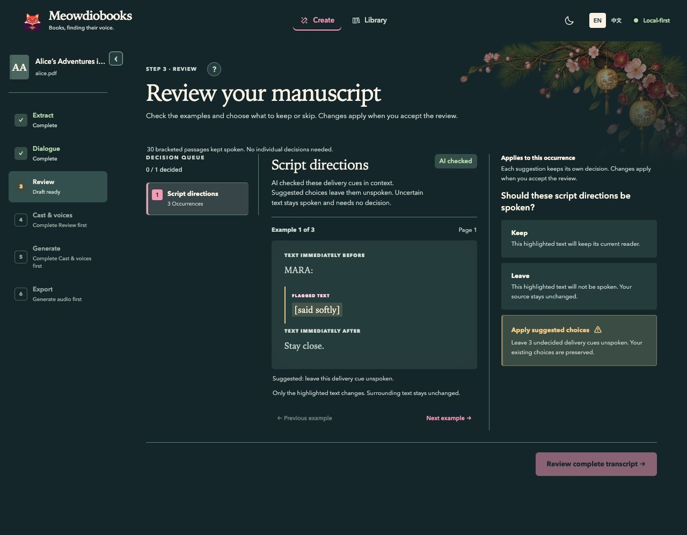
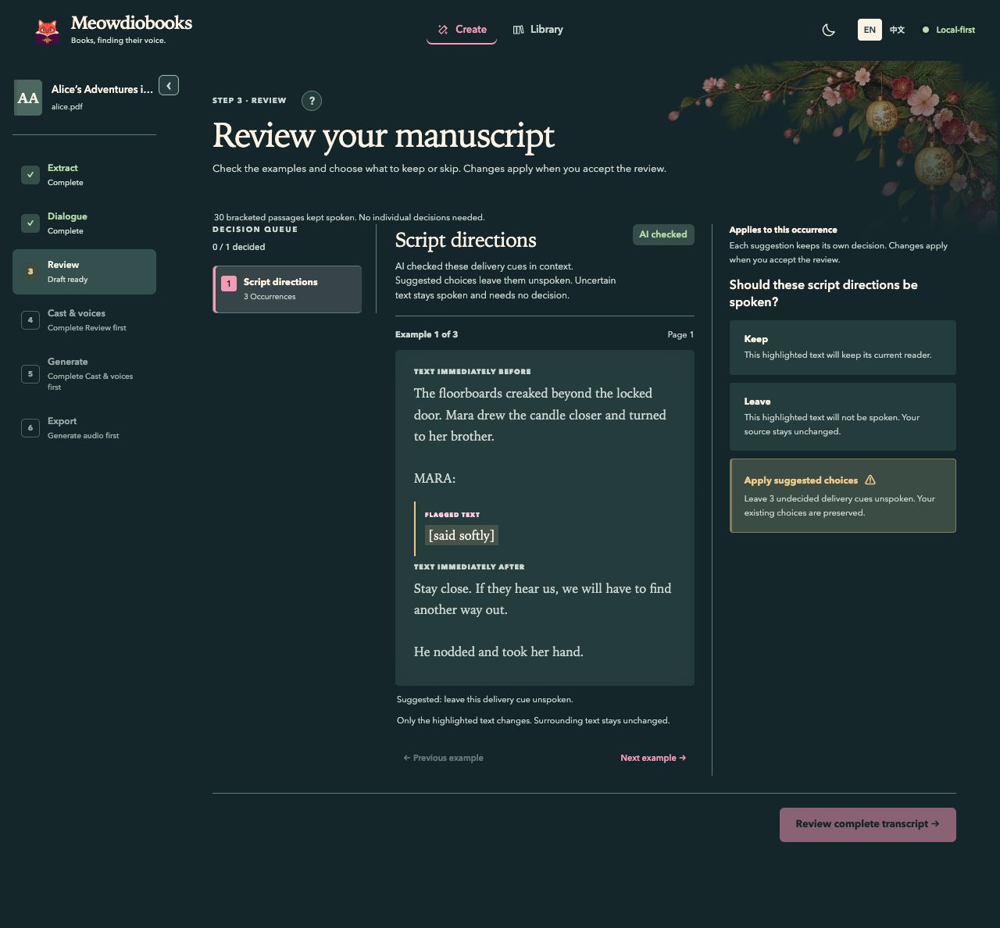

# Review context verification

2026-10-25, macOS, Python 3.12, Node 22, baseline `ac9bd8c`.

The earlier preview could stop at a speaker label or 180 characters mid-sentence. Review now builds
bounded source evidence across extraction blocks, extending to nearby sentence boundaries. This
includes deterministic warnings, AI corrections, verified script cues, and chapter headings. Dialogue
review already provides surrounding lines and expandable context. Source-coverage recovery is a
separate blocked state with no keep/remove decisions, and was not redesigned.

## Visual evidence

The production App with synthetic Storybook fixtures, same desktop viewport and dark appearance:

| Before | After |
|---|---|
|  |  |

Reproduce with `npm --prefix frontend run storybook`, then open
`/iframe.html?id=product-script-directions--suggestions&viewMode=story`.
The example now includes narrative sentences, a speaker label, a complete spoken utterance, and the
following response. The fixture explicitly supplies representative evidence; backend tests separately
verify that real source anchors produce the expanded context.

Browser check: Keep the first example, apply suggested choices on the second, return to the first.
Keep remains selected, the remaining cues are marked Leave, and the transcript action is enabled.
Options retain their existing order; the warning stays on the bulk action.

[Chapter-heading screenshot](assets/review/context/chapters.jpg) shows the same before/after context.
Reproduce at `/iframe.html?id=product-accepted-baseline--review-boundaries&viewMode=story`.

## Automated checks

139 backend tests and 208 frontend tests passed; lint and production build passed.

- `PYTHONPATH=src python -m pytest tests/backend/test_review_context.py tests/backend/test_review_v2.py tests/backend/test_cleanup_review.py tests/backend/test_script_direction_review.py tests/backend/test_chapters_v2.py tests/backend/test_app_v2.py -q`
- `PYTHONPATH=src python -m ruff check src/meowdiobooks tests`
- `npm --prefix frontend run test -- src/App.test.tsx src/reviewDecisions.test.ts`
- `npm --prefix frontend run lint`
- `npm --prefix frontend run build`

Coverage includes speaker-only prefixes, whitespace between blocks, sentence lengths over 180,
explicit truncation for oversized prose, Chinese punctuation, document edges, empty pages, both AI
repairs and source-review fallbacks, saved Extraction chapter candidates, and their persisted Review
API response. Existing tests cover exact source reconstruction, rendering, and manual/bulk choices.
Lint has an existing LanguagePicker fast-refresh warning; build has its existing chunk-size warning.

## Public-domain sample comparison

All three checked-in PDFs passed through native `extract_full_document`, `pages_to_dialogue_blocks`,
default `scan_dialogue`, and `build_review_workspace`. Compared the baseline and changed Review output
recursively after excluding context fields and the new display-only boundary list. All other output
was identical, including warning anchors, kinds, severity, available actions, and source coverage.
No remote model calls or audio generation were needed for this display-only change.

| Sample | Pages | Blocks | Occurrences with richer context | Other Review output |
|---|---:|---:|---:|---|
| Alice | 4 | 59 | 4 / 4 | Unchanged |
| Pride and Prejudice | 4 | 55 | 4 / 4 | Unchanged |
| Ah Q, Traditional Chinese | 2 | 23 | 2 / 2 | Unchanged |

These samples have no detected chapter headings; synthetic backend/API/UI tests cover that case.
An independent agent audited context bounds, anchors, old chapter candidates, and acceptance paths;
no blockers remained. Already saved Review snapshots retain their old context until regenerated.
