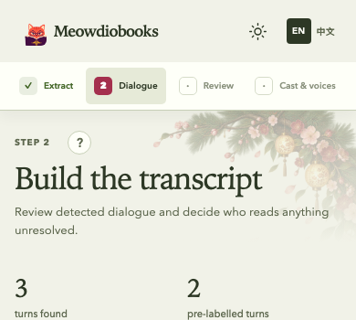
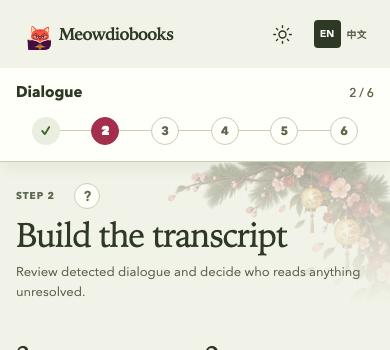

# Mobile wizard navigation and focus audit

2026-10-04. Baseline: `d51bd7c58c1a505981fc03d3941885ae9789b9c3` (workflow UI 0.1.40).
Evidence uses the actual application and public synthetic-book gateway, without backend/provider work.

## Visual comparison

| Before, 390px | After, 390px |
| --- | --- |
|  |  |
|  |  |

Full 390px/1440px light/dark captures are adjacent. The standard six-stage journey fits at 320px
with measured 48×44px targets; at 390px they are approximately 60×44px. Custom longer journeys
retain horizontal scrolling and full stage names/statuses through their accessible names.

## Audit and result

- Mobile navigation: current name and position above numbered/completed markers. Future steps
  remain disabled, previous unlocked stages remain navigable, and `aria-current="step"` is preserved.
- Phase guide: default reading-surface focus replaces initial X focus. First Tab reaches X,
  focus remains trapped, Escape closes, and focus returns to the trigger.
- Export upload and legacy selection labels: `:focus-visible` replaces pointer-driven
  `:focus-within` outlines. Native checkbox/radio treatment remains functional.
- Dialogue route selection: a single card outline replaces the card focus shadow plus inner
  button outline. Existing resting card shadow is preserved.
- Mobile native select proxy: one outline replaces a focus shadow on its visible label.
- Retained purposeful speaker-editor autofocus, new-audition playback focus, input editing
  indicators, native checked states, and inspector/collection focus restoration.
- Hosted native billing entry is Cloud-owned and handled in its separate source PR; no hosted
  payment code or artifact override is introduced here.

## Verification

From `frontend`:

```sh
npm run dev -- --mode studio --host 127.0.0.1 --port 5189
node scripts/verify-mobile-steps-focus.mjs after http://127.0.0.1:5189/studio.html ../docs/assets/review/mobile-steps-focus
npm test -- --run
npm run lint
npm run build
npm run test:consumer
```

The browser script's `before` mode captures original source without the new-layout assertions.
`before-report.json` and `after-report.json` record Chromium and WebKit at 320, 390, 750, and
1440px in light/dark: 16 cases per revision. Layout checks include visible 44px targets, no
six-step navigation overflow, no page overflow, keyboard/pointer modal opening, Tab/Shift+Tab,
Escape/focus return, stage locks and backward navigation. No browser page errors.

An independent reviewer rendered Cast and Export in English and Chinese at 320/390px: eight
additional states, no page/navigation overflow, correct active positions, single keyboard
indicators for upload/chapter/format controls, and no pointer upload outline. Routing was checked
with actual Tab navigation and pointer selection. See `independent-report.json`,
`after-export-320-zh.png`, and `after-routing-keyboard-390.png`.

All 328 unit tests pass. Lint passes with the existing LanguagePicker fast-refresh warning;
production build passes with the existing bundle-size advisory. Packed consumer type checking
and equal-specificity host CSS overrides pass. Browser/server commands require permission to
launch browser processes and bind localhost in restricted environments.

This is local rendered evidence, not an authenticated staging or physical-device verification.
Shared release publication, Cloud adoption, and deployment are separate follow-ups.
