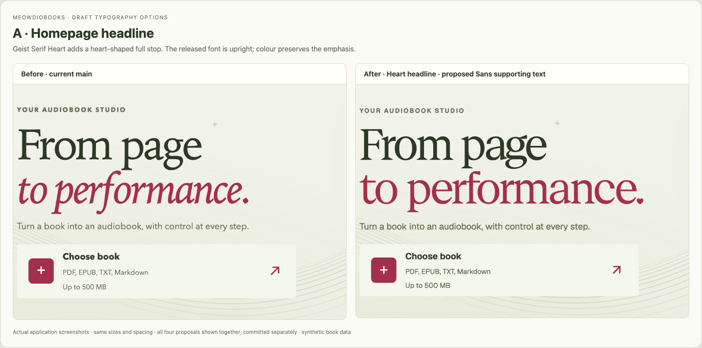
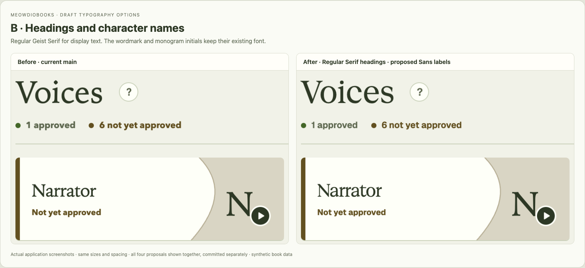
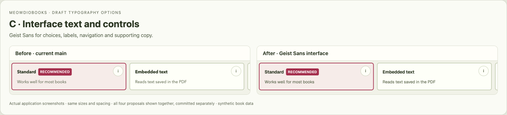
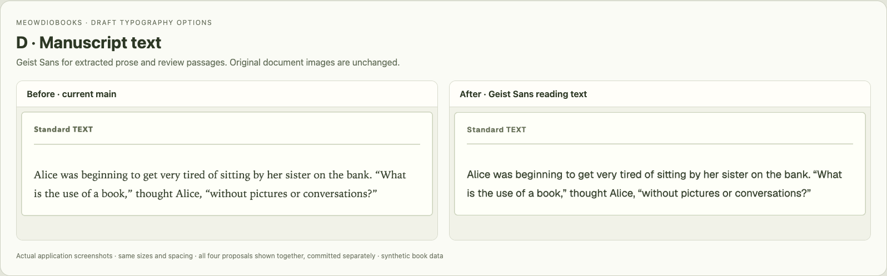

# Geist typography proposals

Status: the owner approved all four proposals on 2026-10-30 and authorized release and Alpha adoption.
The separate commits and original comparisons are retained as the design decision record.
The shared workflow UI and design-system typography belong in this repository.
No host-specific CSS, credentials, operator settings, or release artifacts are changed.

## Choices

| Choice | Proposed use | Commit | Reason |
| --- | --- | --- | --- |
| A | Geist Serif Heart on the Home headline | `72acac4` | A small decorative detail at the entrance to the product. |
| B | Regular Geist Serif on selected page headings, book titles and cast names | `16110a9` | Editorial character for display text, with plain punctuation in working screens. |
| C | Geist Sans for interface copy, navigation, labels and controls | `16d987f` | One bundled interface face across operating systems, with the existing fallback stack. |
| D | Geist Sans for extracted prose, source excerpts and review passages | `ebfc3a0` | Clearer letterforms in small reading and editing surfaces without display-serif hairlines. |

Each choice depends on the font foundation commit `90b643c`; C and D use separate role tokens.
Sizes, line heights, letter spacing, colours, and workflow behavior are retained.
Serif headings use the only released weight, Regular, without synthetic bold or italic.
The wordmark, cast monogram initials, original page images, generated covers, and audio output retain their existing presentation.

The headline “From page to performance.” contains no i or j. The Heart variant changes its final
full stop to a heart. Other supported strings can receive heart dots on i and j naturally;
no literal heart characters are inserted, so the text and accessible name stay the same.
Geist Serif currently covers Latin scripts; Chinese continues through the existing system fallback.

## Before and after

These are real browser screenshots of the same synthetic fixtures, comparing main
`8c3730f0e6d3966798bd79364923f42269491285` with implementation
`ebfc3a019cb06400d190671f9f03828cdeef8987`. The after images show all four proposals together.
The core application's local-edition labels are expected; hosted adoption is a later release/pin step.









## Verification

Environment: macOS 27.0.1 arm64, Node 22.23.4, npm locked dependencies; installed Chrome for
focused typography captures and Playwright Chromium for the existing browser suites.
This is local macOS evidence, not Ubuntu CI or deployment evidence.

| Command / scope | Result |
| --- | --- |
| `npm ci --no-audit --no-fund` | Passed, locked dependencies unchanged. |
| `npm test` | 580 tests passed in 43 files. The existing font-stack assertion was updated for proposal C; its mobile control-size checks remain. |
| `npm run lint` | Passed; two existing Fast Refresh warnings in `LanguagePicker.tsx` and `main.tsx`. |
| `npm run build` | Passed; emitted local WOFF2 assets. Existing large-JS-chunk warning remains. |
| `npm run storybook:check` | Passed. |
| `npm run test-storybook` | 86 browser/accessibility tests passed in 14 files. |
| `npm run build-storybook` | Passed. |
| `npm run test:consumer` | Passed; packed UI works in an independent disposable host. |
| Typography captures | 19 baseline + 19 candidate screens; no page/request errors or horizontal overflow. Font requests succeeded. |

The capture matrix covers Home, Extract and Voices at 1440px and 390px in both appearances;
Review, Generate, Export and Library at 1440px in light appearance; and Home, Extract and Voices
at 390px in Simplified Chinese. Full screenshots and JSON reports are generated locally by the
commands below; the four focused comparison sheets are retained here for review.

The table records the initial design-draft checks. The final release adds the full local CI
equivalents and canonical visual matrix; exact-commit results are recorded on the pull request.
Hosted CI remains subject to the owner-authorized October outage procedure.

## Reproduce the comparisons

From the repository root, archive the exact baseline without changing the checkout:

```sh
baseline_dir=$(mktemp -d)
git archive 8c3730f0e6d3966798bd79364923f42269491285 frontend | tar -x -C "$baseline_dir"
cd frontend
npm ci
PLAYWRIGHT_CHANNEL=chrome TYPOGRAPHY_SOURCE="$baseline_dir/frontend" node scripts/review-typography.mjs /tmp/geist-review/before
PLAYWRIGHT_CHANNEL=chrome node scripts/review-typography.mjs /tmp/geist-review/after
PLAYWRIGHT_CHANNEL=chrome node scripts/compare-typography.mjs /tmp/geist-review
```

Omit `PLAYWRIGHT_CHANNEL=chrome` to use installed Playwright Chromium.
Open `/tmp/geist-review/index.html` to view the four comparisons. The fixtures do not call
real providers or mutate user books.

## Assets and adoption

Four unmodified WOFF2 files total 223,512 bytes, loaded on demand. The [font manifest](../../frontend/src/assets/fonts/geist/README.md)
records package version, source, individual hashes, and the bundled SIL Open Font License.
No JavaScript runtime dependency or Next.js font loader is added. The package's existing `src`
inclusion carries the font files and license to consumers.

All four proposals were selected. Complete normal review/merge gates before publishing. Hosted adoption requires
an immutable release from the merged public commit, verified lock/hash updates and consumer checks.
The owner separately authorized publication, host pin updates, and Alpha deployment on 2026-10-30;
each follows its own verification gates.
