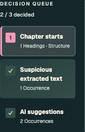
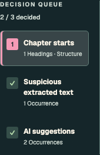
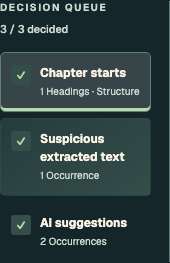
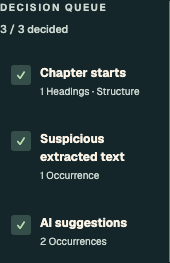

# Mobile review navigation and chapter evidence

On phones (up to 700px), scrolling follows the level of the completed work:

1. Choosing an option advances to the next unresolved example in the current category and scrolls
   to that category's heading. Clicking a category or Previous/Next example also targets the heading.
2. Completing a category selects the next unfinished category in visible queue order, wrapping when
   needed, and returns to the queue with that category focused. It resumes the first undecided item;
   opening its active queue card preserves that position. There is no intermediate Continue button.
3. Completing all categories stays in the current category and reveals **Review complete transcript**.
   Focus moves to this final action; scroll down only if it is below the viewport. The action is hidden
   on mobile before all decisions are complete.

Scroll targets use the measured sticky-header bottom plus 12px, rather than a fixed phone offset.
Short categories get only enough scroll room after the final controls to align correctly; there is
no spacer between choices and the final action. Scrolling is smooth unless reduced motion is requested.
Desktop retains its existing queue navigation, automatic progression, and disabled transcript action
until all decisions are complete. These mobile transitions do not alter desktop behavior. The shared suggestion-card and completed-category
styles described below apply at every viewport size.

Both layouts show all supplied bounded chapter context, including split title lines and opening
passages, with compact paragraph spacing and the exact original anchor highlighted. This is display
context, not a change to extracted source or chapter detection. No original-page viewer or changes
to the existing “All suggestions decided” wording are included. Manual choices, bulk semantics,
transcript preview, and explicit acceptance remain unchanged.

All screenshots use synthetic text and the production App with a fixture gateway. No customer
manuscript, screenshot, account identifier, or service data is included.

| State | Before (`fde4f82`) | Current draft |
| --- | --- | --- |
| Mobile: split chapter title |  |  |
| Mobile: suggested choices finished |  |  |
| Desktop: split chapter title |  |  |
| Desktop: suggested choices finished |  |  |

The completion comparison performs the same actions in both versions: manually keep example 1,
then apply remaining suggestions. Before resets to example 1; the mobile draft selects the next unfinished category.

Opening “Read it once like a listener” and returning to decisions now use the existing page-entry
scroll/focus reset on both mobile and desktop. Transcript loading, paging, and zoom do not retrigger it.

- [Mobile next-example landing](next-example-390.png)
- [Mobile queue landing after category completion](decision-queue-390.png)
- [Mobile final action after all categories complete](all-complete-390.png)
- [Mobile final-check entry](final-check-390.png)
- [Desktop final-check entry](final-check-1440.png)

## Suggestion cards and tablet category states

Suggested choices now match Dialogue’s “Who reads this line?” options: the same outlined sparkle,
warning-soft background, and warning-border tokens. Choosing another option mutes the suggestion;
choosing the suggestion replaces its sparkle with a checkmark and the existing Review selection tint.
Suggestions remain undecided until explicitly selected. The accessible suggestion description remains.

Completed queue cards now consistently have a neutral background and a green checkmark. Only the
current unfinished category has an active highlight. When all categories are complete, none has an
active fill. `aria-current` still identifies the displayed category, and keyboard focus keeps its
existing visible outline. This fixes a shared cascade conflict: legacy completed-card gradients had
higher specificity than the normal card style, but the last-child rule overrode only the last card.

| Tablet state | Before this follow-up (`379c74f`) | Current draft |
| --- | --- | --- |
| Two categories complete |  |  |
| All categories complete |  |  |


## Reproducible verification

Environment: macOS arm64, Node 22.23.4, locked npm dependencies, Playwright Chromium. Native tests;
no Docker, model inference, or live service changes.

```sh
npm --prefix frontend ci
npm --prefix frontend test -- --run
npm --prefix frontend run lint
npm --prefix frontend run build
npm --prefix frontend run storybook:check
npm --prefix frontend run test-storybook -- stories/MobileReviewNavigation.stories.tsx stories/CompactReviewPassages.stories.tsx stories/CleanupReview.stories.tsx stories/AliceReviewPassages.stories.tsx stories/ScriptDirections.stories.tsx
npm --prefix frontend run storybook -- --port 6017
node frontend/scripts/verify-mobile-review.mjs http://127.0.0.1:6017
```

For before/after captures, export baseline `frontend/` into a separate temporary directory, install
its own locked dependencies, and copy only `MobileReviewNavigation.stories.tsx` from the candidate.
Run its Storybook on 6018 and pass `http://127.0.0.1:6018` as the second script argument and an output
directory as the third. Separate node_modules directories avoid sharing Vite optimization caches.

For interactive inspection, open `Product/Mobile review navigation/Suggestions` to start with
undecided suggestions. `Finished category` deliberately completes the suggestions during setup;
`Complete journey` is an automated interaction story rather than an untouched starting point.

Results:

- Frontend suite: 43 files, 592 tests passed.
- Focused real-browser stories: 5 files, 21 tests passed, including existing public-domain Alice
  URL, credits, and verse passages; synthetic split-title, legacy context, script directions,
  source-check-after-bulk, and manual-choice preservation.
- Browser matrix: 320×844, 390×844, 650×1400, 768×844, 834×1112, and 1440×844, light and dark. Each follows the three mobile destinations
  or existing desktop flow, resolves every decision, opens the transcript, returns, and verifies the
  manually kept choice. Before completion the final action is hidden on mobile. After completion it
  is visible/focused, and scrolling never moves upward. No horizontal overflow or axe violations. All 12 viewport/theme cases also verify Dialogue’s
  suggestion color tokens, the sparkle and muted state, and equal neutral styling across completed cards.
- Browser motion checks at 390×600 verify animated movement for both example and category completion,
  plus immediate reduced-motion behavior. A synthetic 104px sticky header verifies measured alignment;
  exact target geometry is checked after scrolling settles. The short-category case verifies that the
  page does not clamp before the heading reaches the header offset.
- Final-check entry and return start at scrollY=0 with main-content focus; transcript loading/paging
  does not trigger another reset. [Machine-readable results](browser-report.json).
- Regression tests cover group-scoped completion from example 3; individual and bulk chapter
  completion; final-button reveal both when already visible and when below the viewport; measured
  header offsets; desktop progression; within-category movement; reduced motion; source checks after
  bulk application; exact source anchors; Chinese/legacy snippets; authoritative preview preservation.
- Build and story typecheck pass. ESLint has no errors; two existing Fast Refresh warnings remain in
  LanguagePicker.tsx and main.tsx. Vite retains its existing large-chunk advisory.
- Independent navigation review checked the three destination transitions, manual overrides, bulk
  policies, and final-button lookup; its targeted 4-file run passed 244 tests before the three
  final-button placement tests were added. Follow-up review reproduced a tall-mobile viewport-floor
  calculation issue; the measurement was fixed and 650×1400 added to the passing browser matrix.
  The final automatic-selection review caught a reset when reopening the active queue card; that
  now preserves the resumed occurrence, verified independently in Chromium and a cycle regression.

## Scroll diagnosis

The previous fixed 110px offset left a gap below the actual phone header. Short categories also hit
the bottom of the document before their heading could reach the desired position. The current code
measures the header and reserves minimal scroll room after the controls. It measures content beyond
the viewport height floor before sizing that space, so very tall mobile viewports also align. That geometry is not animated:
the app's global reduced-motion CSS would otherwise delay even these measurements by a fraction of a
frame. Only the actual scrolling animates. Earlier full-height animation assertions were refined to
use a short viewport where the next heading requires movement; when it is already aligned, no movement
is needed.

Backend extraction/attribution/audio evaluation suites were not rerun: no processing, model,
artifact contract, or accepted book data changed. Relevant public-domain Alice presentation stories
ran; synthetic multiline and Chinese source tests extend presentation coverage. These fixtures prove
UI behavior, not new inference accuracy. A shared release and downstream pin update are required
before Alpha can adopt this change. No deployment is included in this draft.
