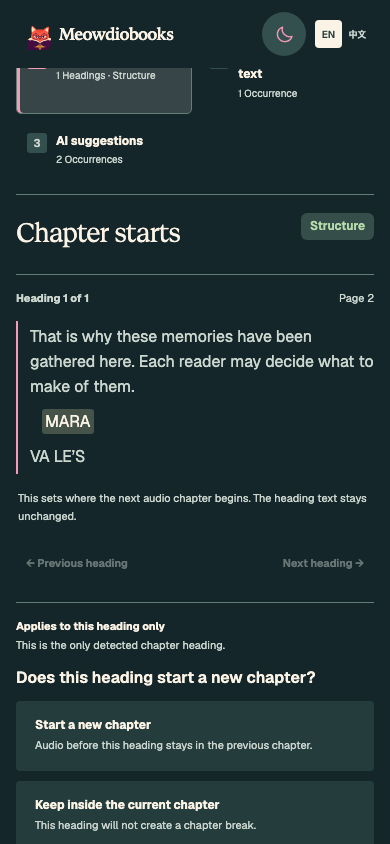
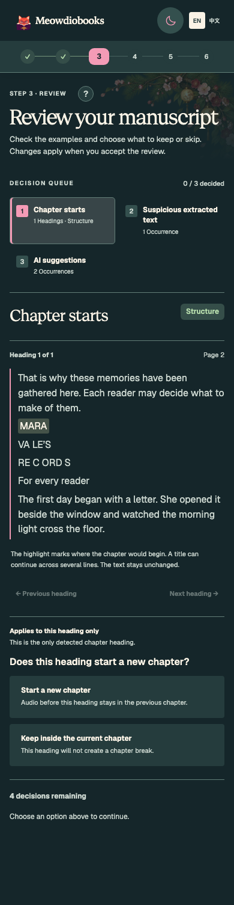
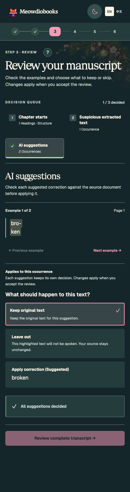
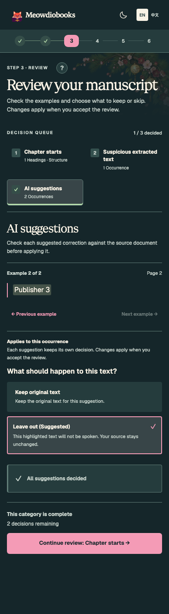
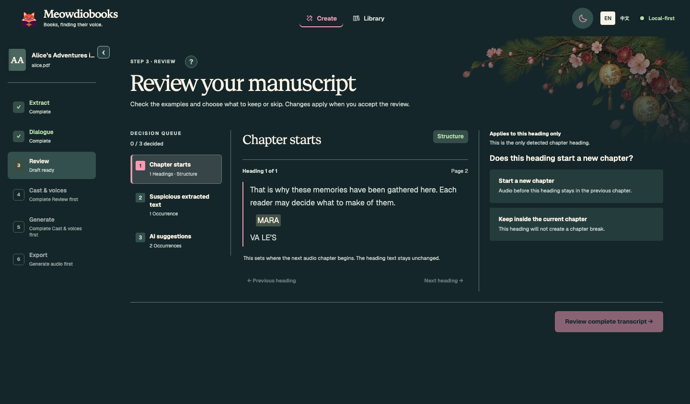
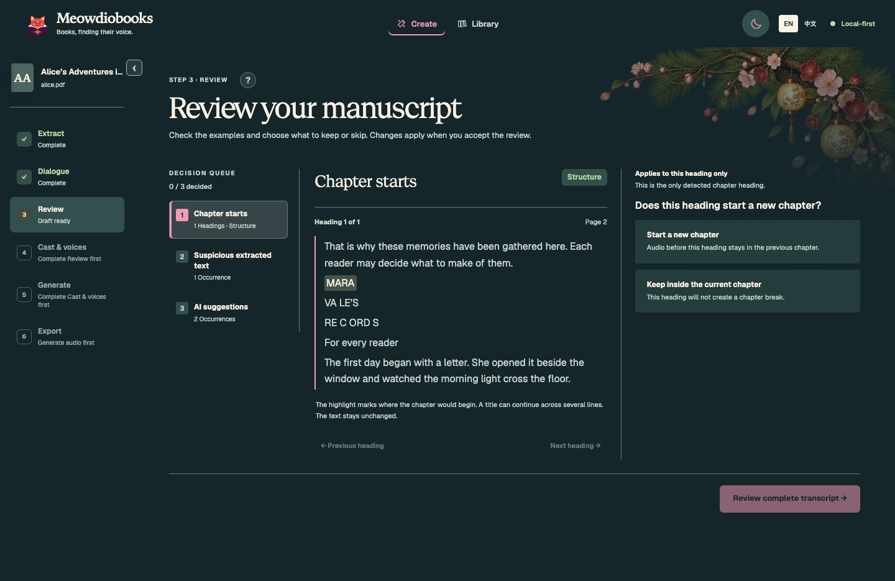
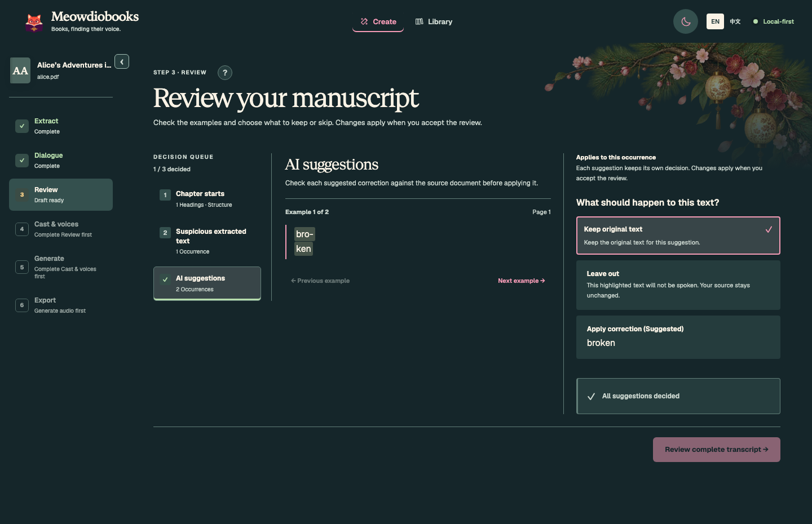
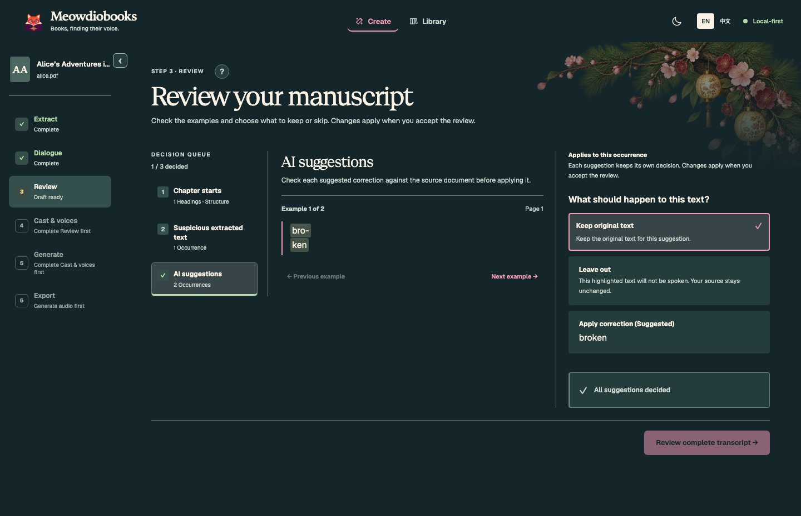

# Mobile review navigation and chapter evidence

On phones (up to 700px), Review shows remaining decisions beneath the choices. Once the current
choice is made, **Continue review: [category]** opens the first unresolved decision and brings its
evidence below the header. The action stays in normal document flow. An unanswered item never
offers a button pointing back to itself.

Completing a mobile category is a stopping point: keep its current example and do not scroll or
switch categories until Continue is chosen. Unfinished examples within a category still advance
and bring the next passage into view. Desktop keeps its existing category navigation, progression,
scroll-to-category behavior, and transcript action; within-chapter navigation does not add scrolling.

Both layouts show all supplied bounded chapter context, including split title lines and opening
passages, with compact paragraph spacing and the exact original anchor highlighted. This is display
context, not a change to extracted source or chapter detection. No original-page viewer or changes
to the existing “All suggestions decided” wording are included. Manual choices, bulk semantics,
transcript preview, and explicit acceptance remain unchanged.

All screenshots use synthetic text and the production App with a fixture gateway. No customer
manuscript, screenshot, account identifier, or service data is included.

| State | Before (`fde4f82`) | Current draft |
| --- | --- | --- |
| Mobile: split chapter title |  |  |
| Mobile: suggested choices finished |  |  |
| Desktop: split chapter title |  |  |
| Desktop: suggested choices finished |  |  |

The completion comparison performs the same actions in both versions: manually keep example 1,
then apply remaining suggestions. Before resets to example 1; the mobile draft preserves example 2.

## Reproducible verification

Environment: macOS arm64, Node 22.23.4, locked npm dependencies, Playwright Chromium. Native tests;
no Docker, model inference, or live service changes.

```sh
npm --prefix frontend ci
npm --prefix frontend test -- --run
npm --prefix frontend run lint
npm --prefix frontend run build
npm --prefix frontend run storybook:check
npm --prefix frontend run test-storybook -- stories/MobileReviewNavigation.stories.tsx stories/CompactReviewPassages.stories.tsx stories/CleanupReview.stories.tsx stories/AliceReviewPassages.stories.tsx stories/ScriptDirections.stories.tsx
npm --prefix frontend run storybook -- --port 6017
node frontend/scripts/verify-mobile-review.mjs http://127.0.0.1:6017
```

For before/after captures, export baseline `frontend/` into a separate temporary directory, install
its own locked dependencies, and copy only `MobileReviewNavigation.stories.tsx` from the candidate.
Run its Storybook on 6018 and pass `http://127.0.0.1:6018` as the second script argument and an output
directory as the third. Separate node_modules directories avoid sharing Vite optimization caches.

For interactive inspection, open `Product/Mobile review navigation/Suggestions` to start with
undecided suggestions. `Finished category` deliberately completes the suggestions during setup;
`Complete journey` is an automated interaction story rather than an untouched starting point.

Results:

- Frontend suite: 43 files, 587 tests passed.
- Focused real-browser stories: 5 files, 21 tests passed, including existing public-domain Alice
  URL, credits, and verse passages; synthetic split-title, legacy context, script directions,
  source-check-after-bulk, and manual-choice preservation.
- Browser matrix: 320, 390, 768, and 1440px, light and dark. Each completes suggestions, uses the mobile
  next-category action or existing desktop queue, resolves remaining decisions, opens the transcript,
  returns, and verifies the manually kept choice. Mobile bulk and chapter completion cause no
  scrollIntoView calls and preserve the current example/category. Unfinished examples still bring
  evidence into focus. No horizontal overflow or axe violations in the final review state.
  [Machine-readable results](browser-report.json); null completion-scroll fields mean desktop, where
  the mobile-only completion behavior is not applied.
- Regression tests cover group-scoped completion from example 3, mobile explicit continuation,
  desktop automatic progression, within-chapter navigation, final-heading completion, remaining
  source checks after bulk application, exact source
  anchors, Chinese/legacy snippets, and authoritative preview payload preservation.
- Build and story typecheck pass. ESLint has no errors; two existing Fast Refresh warnings remain in
  LanguagePicker.tsx and main.tsx. Vite retains its existing large-chunk advisory.
- An independent navigation review found two additional cases: mobile group completion reset its
  example, and desktop within-chapter navigation gained scrolling. Both were fixed and covered by
  regressions; follow-up review found no remaining issue. Its targeted run passed 242 tests across
  4 files. An initial test cleanup scoping error was fixed before the passing full rerun.

## Completion-scroll diagnosis

The regression was in production ReviewPage, not Storybook's manager: `applyAllProposals` reopened
the first suggestion category even after it was complete, calling the mobile evidence-scrolling
handler. In an isolated story iframe, a user click moved scrollY from 460 to 400 and called
scrollIntoView on “AI suggestions” with `{ behavior: "instant", block: "start" }`. The fix avoids that
reopening after mobile completion; explicit Continue owns the next category jump. Story setup can
also drive controls automatically, which is why the new Suggestions starting point is provided.

Backend extraction/attribution/audio evaluation suites were not rerun: no processing, model,
artifact contract, or accepted book data changed. Relevant public-domain Alice presentation stories
ran; synthetic multiline and Chinese source tests extend presentation coverage. These fixtures prove
UI behavior, not new inference accuracy. A shared release and downstream pin update are required
before Alpha can adopt this change. No deployment is included in this draft.
