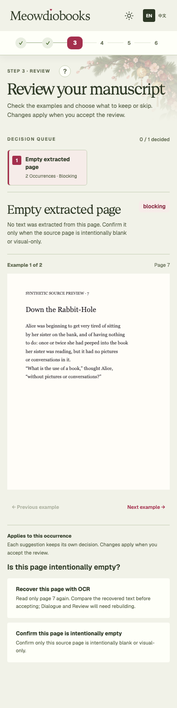
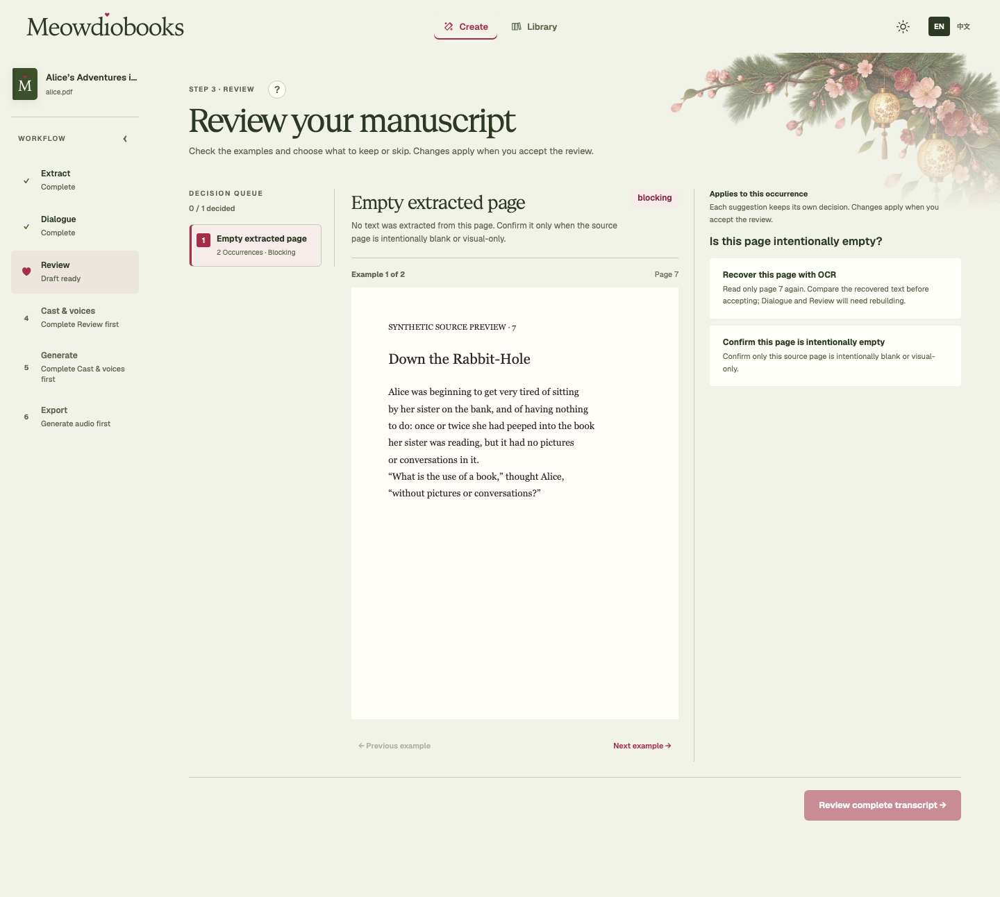
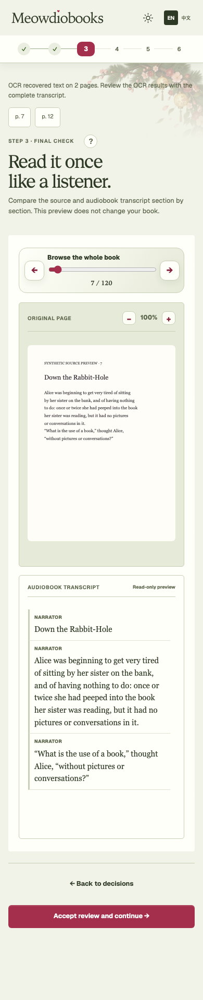
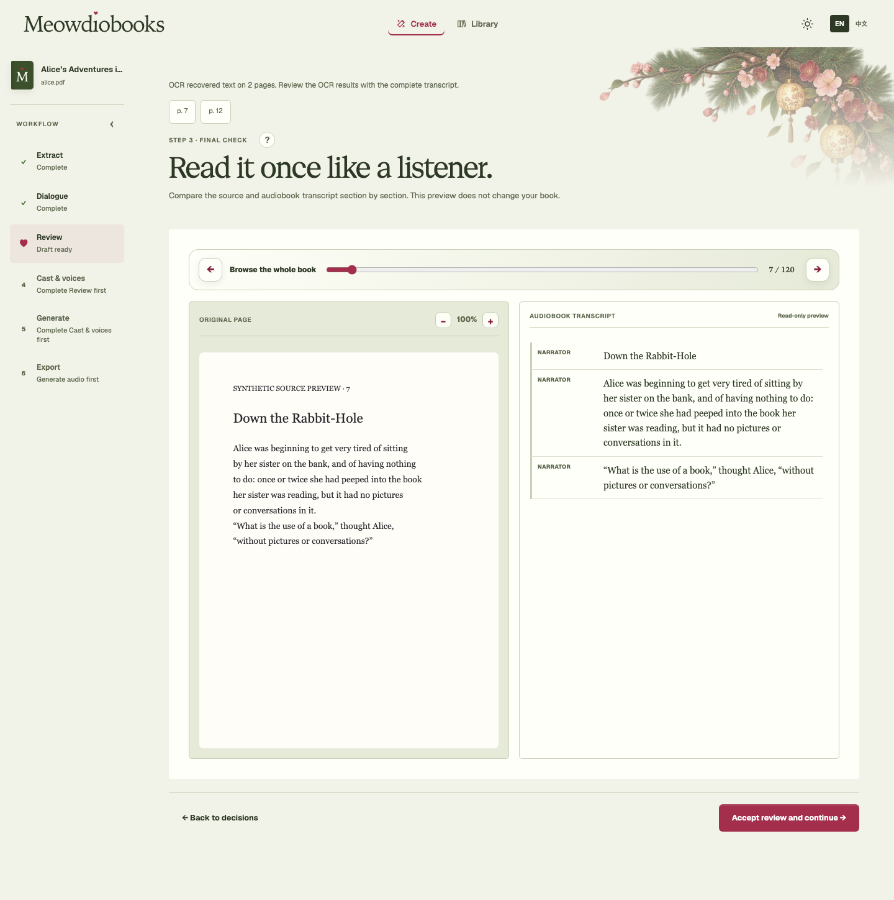
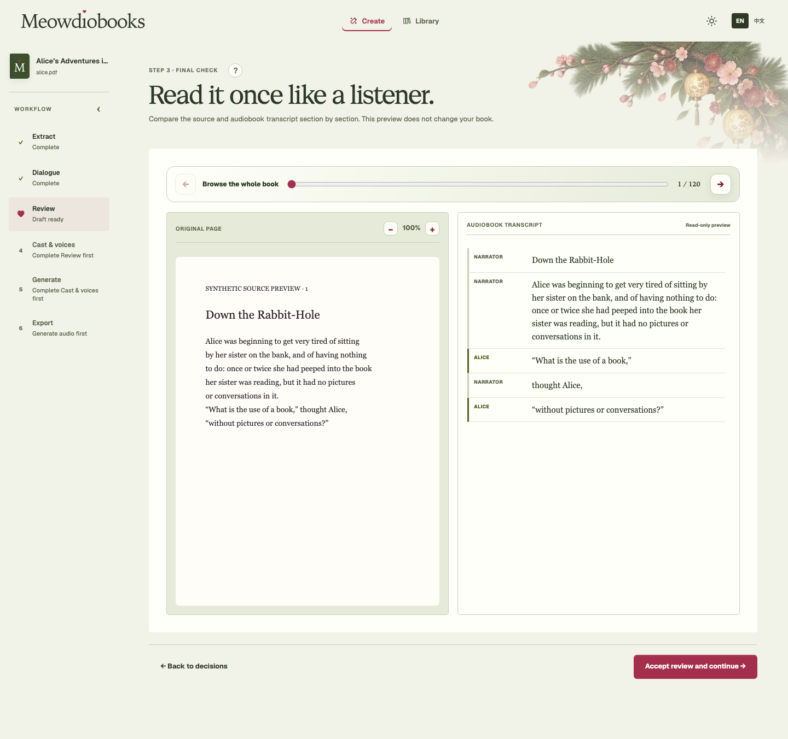

# Per-page and bulk OCR verification

Standard remains recommended and never proactively OCRs a book. A text/image
metadata scan identifies sparse raster pages; Review shows each original page
before an independent confirmation or OCR recovery.

Review supports **Recover this page with OCR** and **Recover all flagged pages
with OCR** for the remaining missing-text pages. Choosing OCR applies its best
effort result and continues within ordinary Review. There is no separate OCR
acceptance screen. If other categories remain, users finish those; otherwise the
existing full-transcript check opens at a recovered physical page.

Blank/unchanged outcomes retain saved text and are reported alongside successful
pages. New text initially uses the narrator. Existing accepted reader assignments
on untouched pages remain exact. Review decisions carry only when their complete
source evidence is unchanged. The normal transcript check remains available for
inspection and final Review acceptance.

The synthetic browser scenarios `review-missing-pages` and `review-ocr-bulk` show
physical page 7 with both OCR scopes, then the existing transcript check without
an additional source approval. Unit interaction tests exercise both scopes,
per-page confirmation, preserved manual choices, skipped OCR results, correct
physical targets and navigation to another book during an in-flight operation.

The source image and final transcript fixture now share the complete heading,
paragraph and quoted passage. A regression check compares every displayed source
word with the fixture transcript; earlier abbreviated placeholder spans were
removed before regenerating the inline PR screenshots.
Ordinary Review also keeps the narrative interruption “thought Alice” with the
Narrator between Alice's quoted parts. The OCR scenario follows the actual
continuation policy: newly recovered pages start as narration; existing reader
assignments on untouched pages stay exact. Recovery does not perform fresh
speaker attribution.

Validation on macOS arm64, Python 3.12 / Node 22:

- `PYTHONPATH=src python -m pytest -q -m 'not uses_audio_decoder and not runs_models'`: 1,676 passed, 3 deselected.
- `python -m ruff check src/meowdiobooks tests`: passed.
- `python scripts/check_publication.py`: passed.
- `npm --prefix frontend test`: 635 passed.
- `npm --prefix frontend run lint`: no errors; two pre-existing refresh warnings.
- `npm --prefix frontend run build` and `storybook:check`: passed.
- `npm --prefix frontend run test-storybook`: 104 passed.
- `npm --prefix frontend run build-storybook`: passed.
- `npm --prefix frontend run test:consumer`: passed.
- `npm --prefix frontend run visual:review -- /tmp/ocr-bulk-visual-review`: 108 scenarios across desktop/phone and light/dark; no overflow, browser errors or accessibility violations.

The three public-domain evaluation PDFs preserve Standard page text: Alice 4
pages/4,455 characters; Pride 4/4,924; Ah Q 2/1,339. OCR-enabled reading of those
digital PDFs preserves the same text after outer whitespace normalization.

Backend cases cover mixed useful/empty batches, no-change batches, technical
failure and cancellation without partial publication, stale Extraction/Dialogue
inputs, atomic paired publication and acceptance CAS, untouched manual speakers,
equal-length changed text without stale corrections, orphaned histories after
restart, and concurrent snapshots. A synthetic real-sandbox API check applied
page 2 OCR while keeping page 1 unchanged, returning an ordinary Review candidate
without an extraction-acceptance request or pending Extraction.

This is native macOS evidence. Hosted CI, consumer release publication and
deployment are separate gates; no Linux-equivalence claim is made here.
