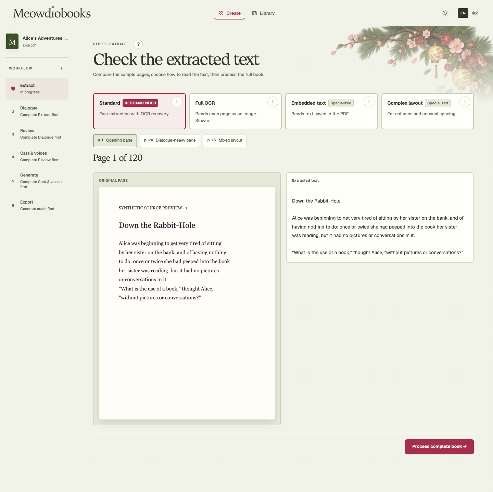
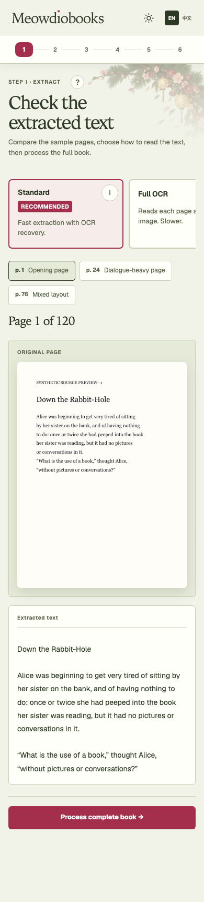

# Extraction with automatic OCR recovery

Standard remains the recommended method. Its sample preview and full extraction
recover useful text from likely image-text pages before Dialogue starts. Normal
speaker detection and Review therefore receive the recovered text in their usual
order. Extraction progress appears in the existing loader.

There is no Review OCR action, empty-page confirmation, separate recovery
acceptance or recovery-specific workflow. The extraction choices are Standard, Full OCR, Embedded text and Complex layout.
Full OCR uses the description **Reads each page as an image. Slower.**
The comparison panel is labeled **Extracted text** for every method. The last two retain
their existing parser behavior and carry a muted **Specialized** label. The short Standard description is **Fast extraction with
OCR recovery.**

The screenshots below use synthetic/public-domain sample text. The sample source
and extracted text contain the complete same passage. Ordinary transcript review
keeps the narrative interruption “thought Alice” with Narrator between Alice's
quoted parts.

## Frontend verification

Native macOS arm64, Node 22:

- `npm --prefix frontend test -- --run`: 627 passed across 45 files.
- `npm --prefix frontend run storybook:check`: passed.
- `npm --prefix frontend run lint`: no errors; two existing refresh warnings.
- `npm --prefix frontend run build`: passed; existing large-chunk advisory.
- `npm --prefix frontend run test-storybook`: 102 browser/accessibility tests passed.
- `npm --prefix frontend run build-storybook`: passed.
- `npm --prefix frontend run visual:review -- /tmp/ocr-extraction-final-visual-review`: 100 canonical checks across desktop/phone and light/dark, with no browser errors, accessibility violations or horizontal page overflow.

Tests retain the explicit OCR extraction method and verify that obsolete empty-page
QA categories do not appear in the decision queue. Synthetic transcript tests
verify complete source coverage and correct narrative interruption ownership.

The prior Review recovery fixtures and screenshots were removed. These browser
fixtures demonstrate the existing UI and do not claim that a real OCR provider ran
inside Storybook. Backend/provider verification is recorded separately on the PR.
Hosted CI, release publication and deployment remain separate gates.

## Backend verification

- `PYTHONPATH=src MEOWDIOBOOKS_TEST_RASTER_OCR=1 python -m pytest -q -m 'not runs_models and not uses_audio_decoder'`: 1,677 passed, three deselected (including the opt-in real raster OCR probe).
- `python -m ruff check src/meowdiobooks tests`: passed.
- `python scripts/check_publication.py`: passed.
- A real local LiteParse/Tesseract check used a synthetic three-page PDF: native
  prose, an image passage with a saved footer, and a blank page. Only physical
  page 2 used OCR; preview and complete extraction returned the same recovered
  passage. The native and blank pages remained unchanged. Before recovery,
  page 2 contained only “Page 115 Publisher”; afterward it also contained all
  three visible story sentences.
- API tests inject a recognizer and verify that recovered dialogue enters normal
  speaker detection (Alice / Narrator / Alice), then ordinary Review. Failure
  preserves accepted artifacts, and saved empty-page candidates no longer
  require a hidden decision.

The sparse-image screen is a heuristic, not a guarantee that every visible word
will be recognized. Full OCR reads rendered pages, even when the PDF has a conflicting saved text
layer. A real synthetic test verifies that visible words are recovered and the
invisible text layer is excluded.

Copy follow-up verification: 223 App tests passed, Storybook types/build passed,
and two focused desktop/phone extraction visual/accessibility checks passed.
The screenshots above were regenerated from this follow-up.

Command-stub file access is confined to the trusted test directory. Regression
tests reject absolute, traversal, sibling-prefix and symlink escapes without
suppressing the CodeQL path-injection checks.
