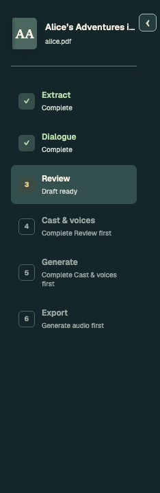
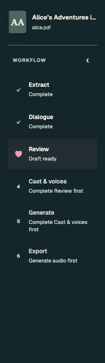
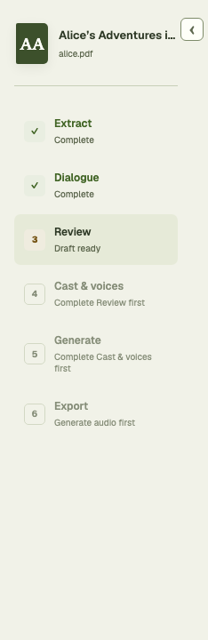
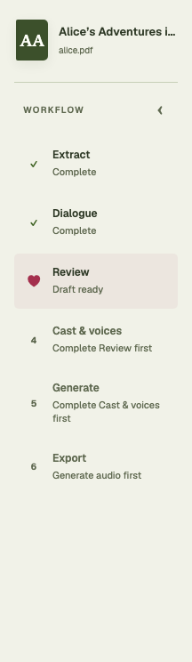
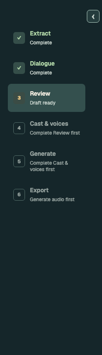
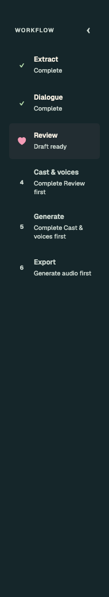
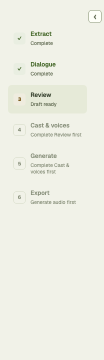
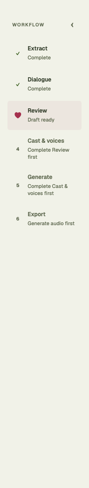

# Workflow sidebar: small heart and internal collapse control

The selected step uses a small heart (18px glyph) and one subtle row tint, replacing nested status boxes and
conflicting selected/draft background colors. Completed inactive steps keep plain green checkmarks;
upcoming steps keep numbers. The step label and status still distinguish current, completed, draft,
and locked states. The collapse control sits inside a Workflow row above the steps, below the book
header when it is visible. The Chinese label is localized. A short window scrolls the sidebar.

This changes tablet and desktop (751px and wider). The phone progress strip, numbered current marker,
stage availability, navigation behavior, collapsed preference, tooltips and accessible stage names
remain unchanged. The heart is decorative; `aria-current="step"` still identifies the current step.

## Before and after

Synthetic fixture captures. Before is the sidebar at `ec0186e`; after is the production implementation,
not the earlier CSS-injected design proposals. Before crops include the protruding collapse control;
after captures cover the rail itself. Different viewport heights expose spacing and scrolling.

| Layout | Before | After |
| --- | --- | --- |
| Desktop · dark |  |  |
| Desktop · light |  |  |
| Tablet · dark |  |  |
| Tablet · light |  |  |

Collapsed, with keyboard focus on the expand control:
[desktop dark](collapsed-1440-dark.png), [desktop light](collapsed-1440-light.png),
[tablet dark](collapsed-834-dark.png), [tablet light](collapsed-834-light.png).

## Reproducible verification

Interactive starting point: `Product/Workflow sidebar/Playground`. It enters Review but makes no review
choices. Use the normal theme button and Storybook viewport controls. `Collapse and navigate` exercises
keyboard-accessible collapse/expand and changing stages while collapsed.

```sh
npm --prefix frontend test -- --run
npm --prefix frontend run lint
npm --prefix frontend run build
npm --prefix frontend run storybook:check
npm --prefix frontend run test-storybook -- stories/WorkflowSidebar.stories.tsx stories/MobileReviewNavigation.stories.tsx stories/CompactReviewPassages.stories.tsx stories/CleanupReview.stories.tsx stories/AliceReviewPassages.stories.tsx stories/ScriptDirections.stories.tsx
npm --prefix frontend run storybook -- --port 6017
node frontend/scripts/verify-workflow-sidebar.mjs http://127.0.0.1:6017
node frontend/scripts/verify-mobile-review.mjs http://127.0.0.1:6017
```

macOS arm64, Node 22.23.4, locked dependencies, native Playwright Chromium; no CI VM started.

- 595 frontend tests across 43 files pass. 23 browser stories across 6 files pass.
- 10 sidebar viewport/theme cases pass: 390×844, 768×1024, 834×1112, 1440×820, 1440×560,
  each in light/dark. Checks cover the current marker, locked stages, internal toggle geometry,
  keyboard collapse, preference persistence, navigating to a completed step and back while collapsed,
  restored expanded state, unchanged phone marker/control visibility, and no horizontal overflow.
- Tablet checks also exercise Chinese labels. Axe reports no sidebar violations in either language.
- [Machine-readable browser results](browser-report.json). Existing review queue/navigation checks
  and their results remain in [the review evidence](../mobile-review/README.md).
- Build and story typecheck pass. Lint has zero errors and the two existing Fast Refresh warnings;
  the existing bundle-size advisory remains.

Frontend presentation only; no extraction, inference, artifact schema or acceptance behavior changes.
No backend/model run, release, downstream pin update or deployment is part of this draft.
