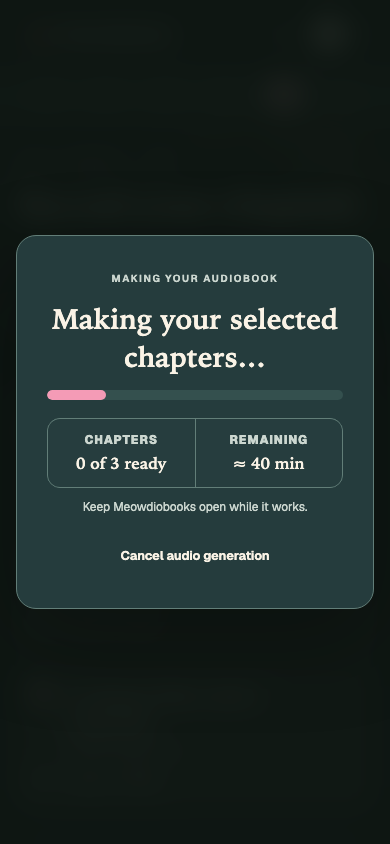
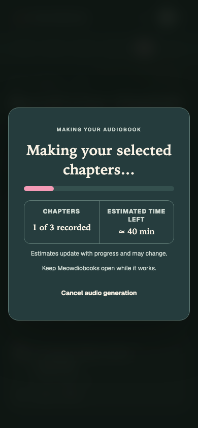
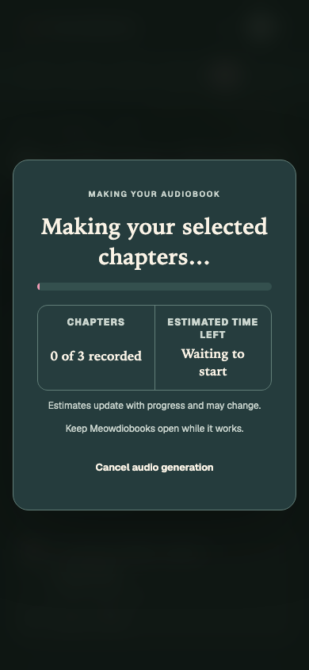
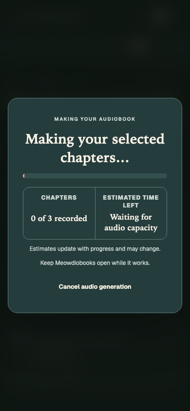

# Generation progress and estimate clarity

The generation overlay now understands parallel renderers' aggregate completion messages as well
as sequential chapter prefixes. Counts are accepted only when the reported total matches the
requested chapter count and the completed count is bounded. “Recorded” describes completed audio
rendering without claiming it has already been published for playback. The exact running status
“Publishing saved chapter audio” keeps all chapters recorded during final publication, preventing
the count from returning to zero before the job succeeds.

The time label explicitly says “Estimated time left,” with an uncertainty note. Queued jobs and
running jobs reporting an audio-capacity wait show the waiting state instead of an unsupported
numeric ETA. Processing-rate arithmetic, host fallback policies, and historical samples are unchanged.

## Browser evidence

Only the synthetic Alice fixture was used. No customer books, data, account identifiers, live jobs,
or production services appear in these artifacts. The before frontend is base
`fde4f82e9f9c90ce61b4f3603c2275b191738d19`, with this PR's synthetic story component copied in and
its new-copy assertions omitted; its production source is unchanged.

The fixture restores a three-chapter job from its workflow location. Running: 20% after ten minutes,
with an aggregate message reporting one chapter completed. Waiting variants: queued or a running
capacity-wait message. The same source is exercised before and after.

| State | Before | After |
| --- | --- | --- |
| Running | 0 of 3 ready; Remaining ≈ 40 min | 1 of 3 recorded; Estimated time left ≈ 40 min |
| Queued | Remaining ≈ 4 min–13 min | Waiting to start |
| Capacity wait | Remaining ≈ 4 min–13 min | Waiting for audio capacity |

All three states were checked at 390 × 844 and 1440 × 1000, in light and dark appearances,
before and after: **24 browser captures/checks**, with zero horizontal overflow, dialog content
overflow, or uncaught browser errors. The phone captures below were visually inspected.

| Before running | After running |
| --- | --- |
|  |  |

| Queued | Waiting for capacity |
| --- | --- |
|  |  |

Reproduce with `npm --prefix frontend run storybook -- --port 6019 --ci`. Visit
`/iframe.html?id=workflow-generation-estimates--running&viewMode=story&appearance=dark`, substituting
`queued` or `waiting-for-capacity`, and `appearance=light`. Wait for `[data-scenario-ready]`.
The story's play function asserts the completed count, estimate label, explanatory copy, and waiting
states. The existing resume/cancel and generation-completion stories cover recovery and completion.

## Verification

macOS, Node 22; no Docker VM or model service required:

- `npm --prefix frontend test -- --run`: **600 tests passed**.
- `npm --prefix frontend run test-storybook -- stories/GenerationEstimates.stories.tsx stories/GenerationResume.stories.tsx stories/GenerationCompletion.stories.tsx stories/Product.stories.tsx`:
  **50 Chromium stories passed**, including accessibility checks.
- `npm --prefix frontend run lint`: passed with two existing Fast Refresh warnings.
- `npm --prefix frontend run build`: passed with the existing bundle-size advisory.
- `npm --prefix frontend run storybook:check`: passed.
- `git diff --check`: passed.

The full-suite results above were recorded at `43bbfd98a7d4e840b2f5a5d9e79264326e852c43`.
The subsequent publishing-count correction passed
`npm --prefix frontend test -- src/workflow/generation.test.ts src/App.test.tsx` (**226 tests**),
ESLint on the two changed generation files, and `git diff --check`. Its two new regression tests cover
the complete status sequence and reject stale/nonmatching publishing messages. The integrated release
candidate must receive its own final validation.

Unit and application tests cover aggregate count bounds and total mismatches, malformed messages,
legacy sequential statuses, the rendering-to-publishing transition, terminal progress, missing context,
queued jobs with stale progress,
capacity waits, observed-rate estimates, host fallback policy, and historical estimates. Independent
review identified a queued job with stale 100% progress as an edge case; the queue guard now takes
precedence, with a regression assertion. No other correctness issue was found in this scope.

The public-domain PDF extraction/dialogue attribution matrix is not applicable: this changes only
presentation of existing job state, with no changes to book processing, chapter splitting, synthesis,
export, or generated artifacts. Existing synthetic/public-domain Alice workflow fixtures exercise the
affected generation surface. No throughput benchmark or voice-quality claim is made.

## Limits

This is clearer progress reporting, not faster generation or a new calibration. Estimates still use
observed elapsed time and percentage after enough progress; capacity waiting included in a backend's
`started_at` can continue to influence the estimate after rendering resumes. Aggregate count and
capacity-wait recognition use the current exact message contracts; unknown messages retain the
existing fallback behavior. A future structured progress contract could remove that dependency.
