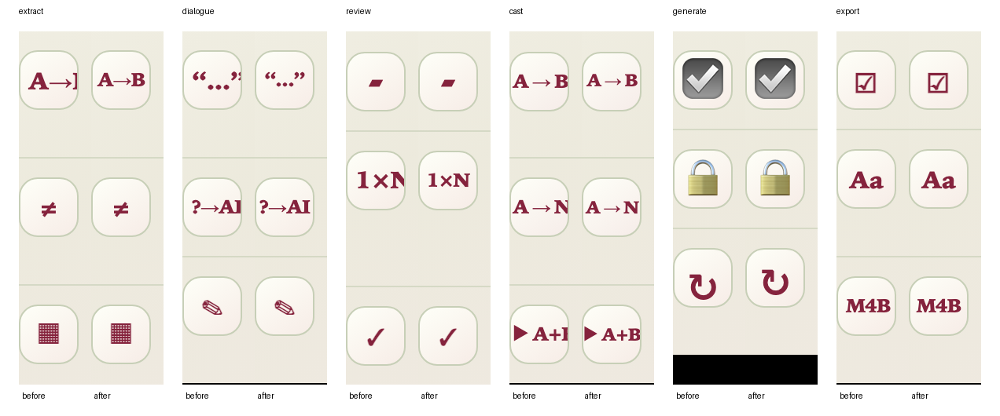

# Phase help modal overflow

All six phase guides scrolled horizontally, and several "Worth knowing" cues were clipped off-centre.

- **Horizontal scroll.** The guide's decorative glow sits 120px past the right edge. `.phase-help` sets `overflow:hidden`, but the shared `.dialog-surface` rule loads later with equal specificity and restores `overflow:auto`, so every guide surface scrolled sideways by 120px. `.phase-help.dialog-surface` now clips; only the guide body scrolls.
- **Clipped cues.** Cues were compacted only above three characters, so wide three-glyph cues (`1×N`, `A→B`, `“…”`) kept the 15px size, outgrew the 30px content box and spilled right. Cues of three or more characters are now compact, the cue box uses 2px inline padding and centres its content, and the cast cues use 11px with no inline padding. The export-only `M4B` override is now covered by the compact rule.

## Verification

- `npm test`: 619 passed, 1 failed. The failure (`src/api/client.test.ts` › downloads an M4B with the server-provided filename) fails identically on `main` without this change.
- `npm run lint`: no errors; two existing Fast Refresh warnings.
- `npm run build`: passed (existing bundle-size advisory).
- Headless Chromium against Storybook `product-accepted-baseline--{extract,dialogue,review,cast-voices,generate,export}`, guide opened, at 1280×800 and 390×844. For each guide the run records whether the surface can scroll horizontally, whether each cue's content fits its box, and the cue text's left/right insets. Raw results: [metrics-before.json](metrics-before.json), [metrics-after.json](metrics-after.json).

| Guide | Before: scrolls sideways | Before: clipped cues | After |
| --- | --- | --- | --- |
| Extract | yes | `A→B` | no scroll, all fit |
| Dialogue | yes | `“…”`, `?→AI` | no scroll, all fit |
| Review | yes | `1×N` | no scroll, all fit |
| Cast & voices | yes | `▶︎ A+B`; on phone also `A → B`, `A → N` | no scroll, all fit |
| Generate | yes | none | no scroll, all fit |
| Export | yes | `M4B` on phone | no scroll, all fit |

After the change every cue has equal left and right insets. Headless Chromium uses overlay scrollbars, so the sideways scroll is recorded in the metrics rather than visible in screenshots.

