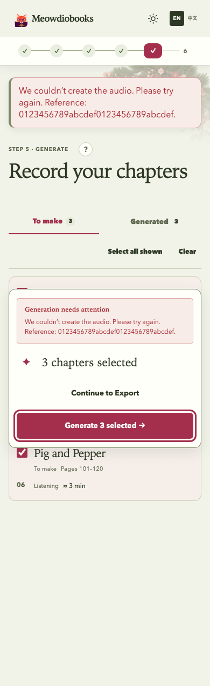
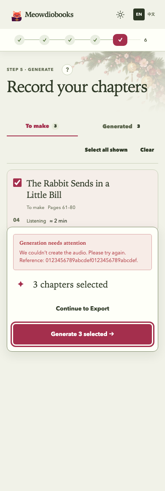

# Single generation failure presentation

The built-in Generate page now owns errors from its generation request when its action dock is
visible. It presents one localized alert beside the action, including the opaque support reference.
The shell remains responsible for unrelated errors, workflow-return Retry actions, custom steps,
and screens without a generation action. Handled host actions still suppress ordinary errors.

## Browser evidence

Synthetic Alice fixture only; no private books, accounts, providers or audio jobs were used.
The before build is main `0bdb4d7338cbe93a4c9f57b9e28e189cafa25259` with the same synthetic
reference-bearing error substituted in its Storybook fixture and expected copy. Production source
in that build was unchanged. The after build uses this change.

| Viewport | Appearance | Before message copies | After message copies | Horizontal overflow | Browser errors |
| --- | --- | --- | --- | --- | --- |
| 390 × 844 | Light | 2 | 1 | 0 | 0 |
| 390 × 844 | Dark | 2 | 1 | 0 | 0 |
| 1440 × 1000 | Light | 2 | 1 | 0 | 0 |
| 1440 × 1000 | Dark | 2 | 1 | 0 | 0 |

All after cases had exactly one `role=alert`, inside the Generation action region. The reference
and retry button remain legible. Full-page phone captures show the same fixed action dock:

| Before | After |
| --- | --- |
|  |  |

Reproduce with `npm --prefix frontend run build-storybook`, serve `frontend/storybook-static`,
and visit `/iframe.html?id=product-accepted-baseline--generate-failed&viewMode=story&appearance=light`
(or `appearance=dark`). Wait for `[data-scenario-ready="generate-failed"]` before inspection.
The committed story asserts one alert in the action region with the safe message and reference.

## Automated verification

Python/backend behavior is unchanged. On macOS with Node 22:

- `npm --prefix frontend test -- --run`: **488 tests passed**.
- `npm --prefix frontend run test-storybook -- stories/Product.stories.tsx`: **43 browser stories
  passed**, including the configured accessibility checks.
- `npm --prefix frontend run lint`, `npm --prefix frontend run build`,
  `npm --prefix frontend run storybook:check`, and `git diff --check`: passed. Existing
  LanguagePicker Fast Refresh warning and production bundle-size advisory remain.

Regression coverage exercises synchronous dispatch, immediate failed jobs and polled failed jobs;
single-copy references; retry clearing; saved audio; custom step fallback; unrelated split errors
after generation failure; all-ready/no-action snapshots; Chinese localization; restored-job global
Retry ownership; and handled/unhandled host actions.
