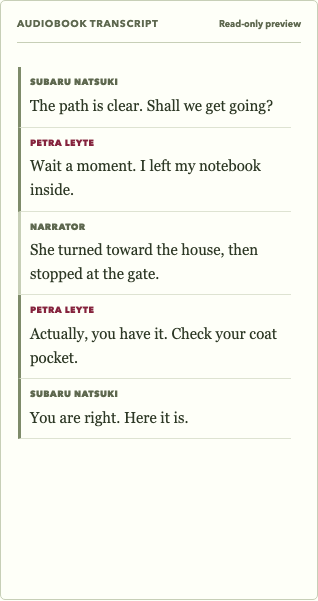
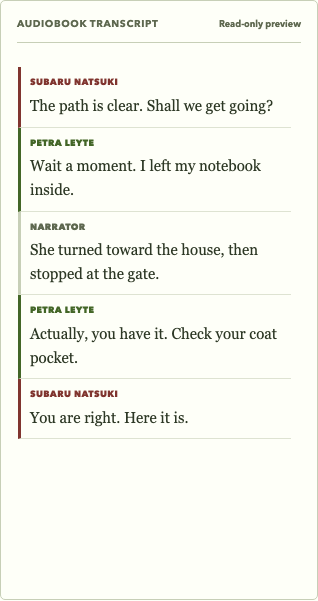
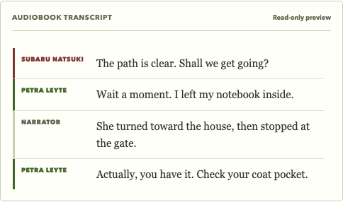
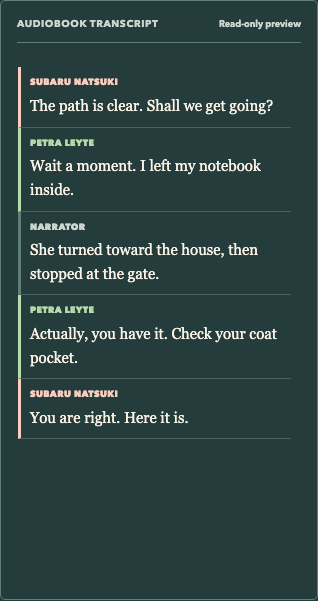
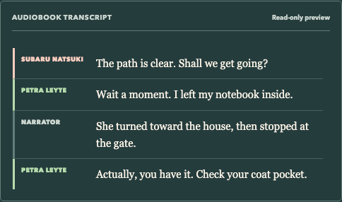

# Transcript speaker accents

The final transcript previously alternated label color by row parity and used the same neutral left border for all dialogue. Speaker accents now derive from a normalized name and a fixed palette of existing cherry, matcha, honey and blended design tokens. The same speaker retains its accent across pages and repeated turns; narration and exclusions keep their existing treatment. A finite palette can repeat for larger casts; visible names remain the identity cue.

## Verification

- `npm ci --offline --ignore-scripts`: 388 packages installed from the lockfile.
- `npm test -- src/workflow/speakerColor.test.ts src/components/CastIdentityReview.test.tsx`: 18 tests passed.
- `npm run lint`: no errors; existing LanguagePicker Fast Refresh warning. The local-only preview entry also emits a Fast Refresh warning and is not included in this change.
- `npm run build`: passed (existing bundle-size advisory).
- Chromium rendered the real `ReviewTranscriptFinalCheck` component using five synthetic turns (Subaru, Petra, narration, Petra, Subaru), at 390px and 1440px in both appearances. No page errors or document overflow. Computed label and border colors match; repeated speakers retain their colors.
- Axe `color-contrast` audit of the transcript pane passed for all four cases. Computed results are in [computed-colors.json](computed-colors.json).

Before/after screenshots use synthetic text. The before image reapplies the original row-parity CSS to the same fixture.

| Before phone | Updated phone | Updated desktop |
| --- | --- | --- |
|  |  |  |
| |  |  |
