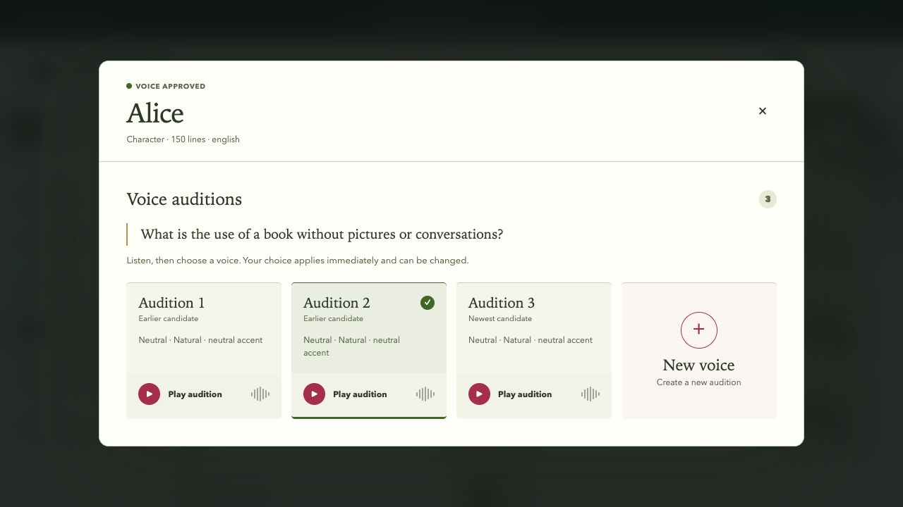
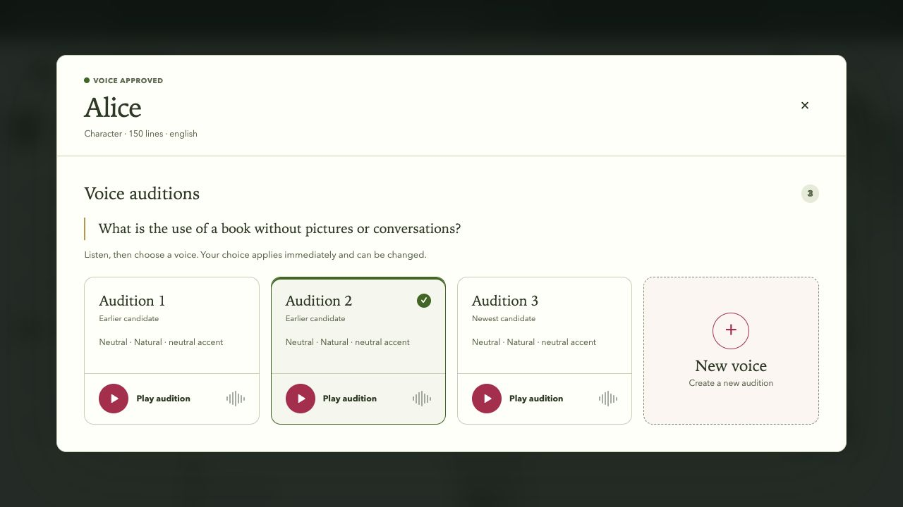
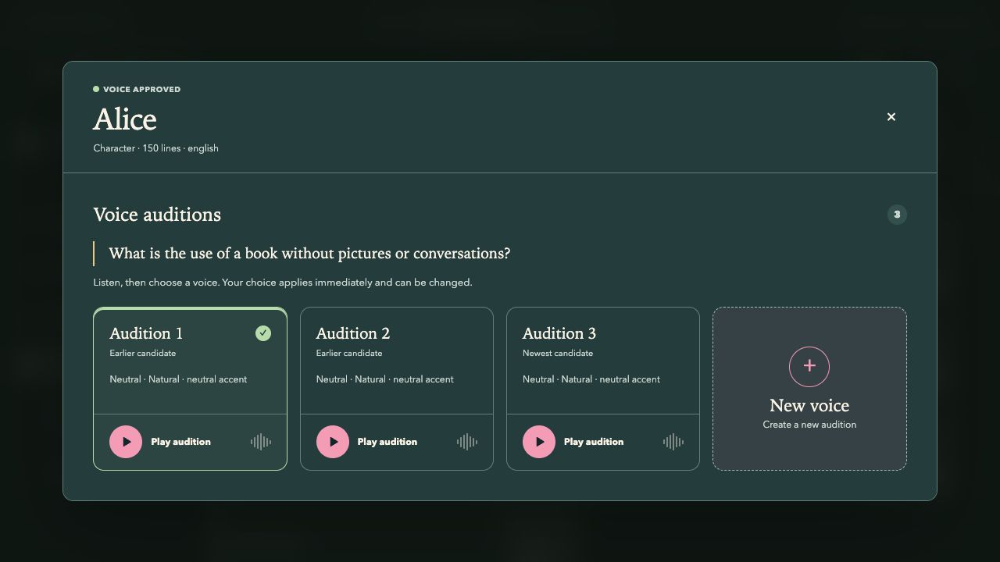
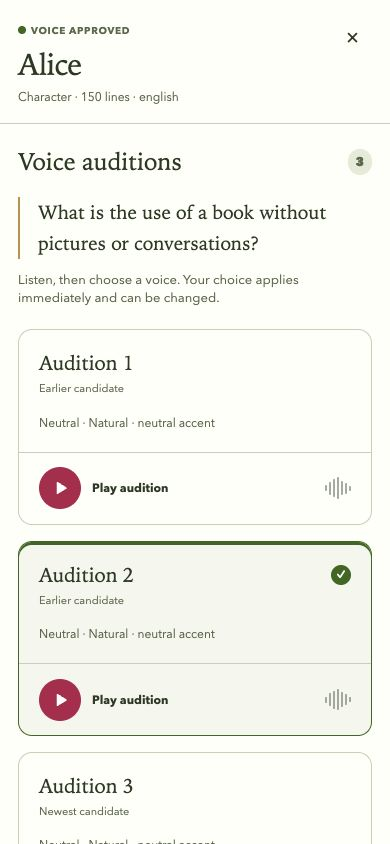
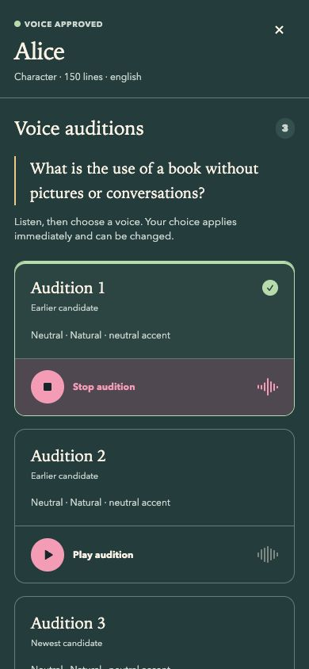

# Voice audition controls · 0.1.57

The shared Core owns these audition cards, playback controls and design-system styles.
No hosted behavior, provider configuration or Cloud override is included.

The comparison uses wider, softly bordered cards, more space around the audition details,
and a 72px playback row with a 42px vector play/stop mark. Applied cards retain the
checkmark and use an inset green edge without changing their dimensions. Roster playback
cues grow to 28px; uploaded-sample playback uses the same vector geometry in a 44px control.
The inspector widens to 1120px so three auditions and New voice still fit side by side
at a 1280px viewport. The phone layout remains one column. The sample preview uses three columns on phones
when the elapsed-time field is hidden, retaining space for the filename and Replace action.

Ordering, exact-revision application, first-playable defaults and audio lifecycle logic
are unchanged. The aligned workflow UI and Python distribution version is 0.1.57.
Publication and consumer adoption are separate follow-up work.

## Reproduce

From this Core checkout, run `npm --prefix frontend run dev -- --host 127.0.0.1 --port 5187`
and open `/studio.html`. Choose **Cast · audition inspector**. This uses the production
component with synthetic Alice fixture data; it does not demonstrate real-book generation.
The baseline is merged Core commit `defaf7fafca9afef3b77ca96100b879d2b7a1c35`.

Browser review used CUA on 2026-10-23 at 1280×720 and 390×844, light and dark themes.
Played and stopped Audition 1, applied it, and observed the same audition order and
stable card geometry. The active control changes to a square stop mark and restores
the play mark on stop. Phone cards remain inside the viewport and the inspector scrolls.

## Validation

- `npm --prefix frontend test -- --run`: 34 files, 421 tests passed.
- Focused `CastVoiceReview.test.tsx`: 22 tests passed, including ordering, default selection,
  playback, interruption and sample-preview coverage.
- `npm --prefix frontend run build`: passed; existing large-chunk advisory remains.
- `npm --prefix frontend run lint`: no errors; existing `LanguagePicker.tsx` fast-refresh warning.
- `git diff --check`: passed.
- Backend code is unchanged; backend generation and real-book evaluation were not rerun.

## Evidence

All screenshots contain only deterministic synthetic fixture data.

Before:

After:

